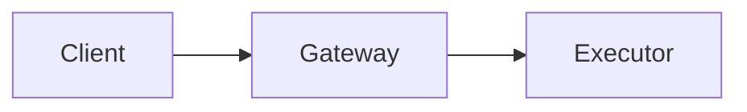

# Markdown 图文交互协议 v1

本文约定 v1 实验性 Markdown 图文协议。图体使用原生 Mermaid，文档声明负责关联解读和阅读步骤。图表风格由宿主站点配置。

## 内容组织

只画图时使用普通 `mermaid` 围栏。需要关联解读、链接或步骤时，用 `::: diagram id="request-path"` 和结束标记 `:::` 包住一个 `mermaid` 围栏，按需加入一个 `diagram-view` YAML 围栏。正文写在图容器外。

图、步骤和时序消息的 ID 以英文字母开头，后续可用英文字母、数字、下划线和连字符。图 ID 在文档内唯一，步骤和消息 ID 各在所属图内唯一。

## 架构与流程示例

~~~~markdown
::: diagram id="request-path"



```diagram-view
version: 1
details:
  "node:gateway": "#gateway"
steps:
  - id: accept
    title: 接收任务
    focus: ["node:client", "edge:submit", "node:gateway"]
    ref: "#gateway"
  - id: dispatch
    title: 分派执行
    focus: ["node:gateway", "edge:dispatch", "node:worker"]
```

:::

## 请求网关 {#gateway}

负责请求接纳和执行实例路由，具体实现位置在这里说明。
~~~~

反引号和波浪线都可用作围栏。

## 配置字段

| 字段 | 含义 |
| --- | --- |
| `version` | 必填，固定为 `1` |
| `overview` | 无当前步骤且未选择对象时展示的正文锚点 |
| `details` | 元素引用到本文档正文锚点的映射 |
| `links` | 元素引用到“打开关联文档”链接的映射 |
| `steps` | 一项或多项讲解步骤，按给定顺序展示。无需步骤时省略 |
| `steps[].id` | 图内唯一的步骤 ID |
| `steps[].title` | 非空的步骤标题 |
| `steps[].focus` | 一个或多个已有元素的引用数组 |
| `steps[].ref` | 当前步骤使用的正文锚点，可省略 |

`overview`、`details` 和步骤的 `ref` 都引用本页标题。标题写成 `## 请求网关 {#gateway}`，在 YAML 中把锚点值加引号，写成 `"#gateway"`。解读取该标题和下一个同级或更高级标题之前的内容。

`links` 接受站点内相对当前 Markdown 的路径，例如 `./recovery-sequence.md#cursor`，也可直接指向本页锚点。目标文档和锚点须存在。点击元素后，再点“打开关联文档”跳转。

配置步骤后默认显示第一步。未填 `ref` 的步骤只显示标题和高亮。想让静态图默认显示总览，可配置 `overview` 并省略 `steps`。

### 元素引用

引用使用图中的 ID 或别名。

| 图类型 | 可用的引用 |
| --- | --- |
| `flowchart` / `graph` | `node:gateway`、`group:host`、`edge:submit`。被引用的边须有显式 ID，如 `client submit@--> gateway` |
| `block` / `block-beta` | `node:ID`、`group:ID`、`edge:原生边ID`。边 ID 写法见[静态分层架构](#静态分层架构) |
| `sequenceDiagram` | `participant:C` 使用参与者别名 `C`，`message:submit` 使用[消息标识](#时序消息标识) |
| 其他图类型 | 可用 `overview` 关联总览 |

### 只在侧栏展示解读

将 Markdown 章节放入 `diagram-details`，即可只在解读栏展示。引用方式仍是 `overview`、`details` 或步骤的 `ref`。下例替换前面示例的 `#gateway` 章节。

~~~~markdown
::: diagram-details

## 请求网关 {#gateway}

接收请求并分配运行实例。

```json
{"accepted": true}
```

:::
~~~~

`diagram-details` 从标题开始，用 `:::` 结束，容器之间不能嵌套。每个顶层章节都须被图文声明引用，子标题随所属章节展示。图定义放在容器外。普通章节被引用后仍在正文中展示。

原章节锚点可直接打开图旁的解读。多个图或步骤引用同一章节时，定位到第一个匹配项。

## 静态分层架构

职责分层适合使用 Mermaid 原生 block 图：columns 声明列数，block:ID["层名与职责"] 和 end 组成复合块，外层 columns 1 将各层从上到下排列。原生 space 预留列，使层内调用横向衔接、跨层交接垂直对齐。用 -->、==> 和 -.-> 区分普通、强调与虚线关系；图的网格与连线不进入 diagram-view。完整示例见 [Agent 分层架构与流转](../examples/compare/tool-workflow.md)。

block 适配支持 node:ID、group:ID 及 edge:原生边ID 关联正文、选择与高亮。Mermaid 12.3.0 为 block 的边生成序号和端点组成的 ID，例如 edge:1-chat-planner；同一对端点的并行边具有不同序号。图上只显示作者提供的标签，原生标识用于引用。复合块为固定布局分组，当前不提供收缩按钮。

静态架构应在图中保留层内调用、跨层交接、条件分支和结果返回。选择组件或路线后读取对应的 `details` 章节。

### 职责泳道与发布阶段

有明确职责和阶段的流程使用 block 网格，外层 columns 1 将职责从上到下排列，每条职责泳道用同样的列数表示阶段推进。原生 `space`、`space:列数` 和复合块后的 `:列数` 保留空列与跨列检查/恢复分组。完整例子见[发布交付](../examples/compare/release-delivery.md)。泳道和阶段不是自动布局的普通 subgraph：转换时必须保留它们表达的责任与阶段，不能只对照节点数量。

在泳道复合块上声明原生 `class lane_0,lane_1 ccv-swimlane`，启用网格排布和正交避让。标题用 `ccv-layer`，阶段标题可用 `ccv-phase`。列、跨度、卡片形状和连线均写在 Mermaid 图体中。泳道复合块与其他 block 分组一样使用固定展开布局。

连线保留原生方向、箭头、粗细及虚实线，按测量后的卡片和标题避让；关系文字参与后续路线避让。向上的恢复回边采用侧边通道，与向下的交接区分。长图初始保持阅读字号，从左上方开始阅读，用户可以显式选择全图、适宽或缩放；节点选择不移动镜头。

## 原生 Mermaid 职责标记

流程图和 block 可用原生 class 标记职责，例如 `api[API]:::ccv-backend` 和 `class submit ccv-backend`。时序图可写 `properties API: {"ccvRole":"backend"}`。

可用职责有 `frontend`（客户端）、`backend`（服务）、`database`（存储）、`security`（安全）、`messagebus`（消息）、`cloud`（云基础设施）和 `external`（外部对象）。作为 class 使用时加 `ccv-` 前缀。block 的 `ccv-layer` 用复合块标签作为层标题，额外的说明节点可标记 `ccv-layer-heading`。

## 附加图语义

原生 Mermaid 表达节点、连线、字段、层级和时间。需要区分图的用途或补充原生语法没有的语义时，可添加以下注释。普通 Mermaid 阅读器忽略注释，仍能显示基础图；展示风格继续由宿主选择。

~~~mermaid
%% ccv:diagram {"kind":"architecture"}
flowchart LR
  client[Client] request@--> gateway[Gateway]
  %% ccv:node gateway {"brand":"nginx"}
  %% ccv:edge request {"variant":"security"}
~~~

| 声明 | 可用语义 |
| --- | --- |
| ccv:diagram JSON | kind 为 architecture、workflow、sequence、dataflow、lifecycle、erd、class、tree、timeline 或 waterfall；可选 locale、timezone、unit、evidence 与 legend |
| ccv:node ID JSON | 已有对象的 kind、sublabel、tag、detail、brand、icon、step；工作流/状态主路径用 main；瀑布父 span 用 parent |
| ccv:edge ID JSON | 已有关系的 variant（default、emphasis、dashed、security、return）、role（main、branch、error、return）与 classification |
| ccv:group ID JSON | 已有分组的 kind 和 variant，额外支持 exception 表达异常泳道 |

语义属性按图类型使用。例如 ER 的 `tag` 表示领域，时间线的 `kind` 表示事件类别。主路径标记由已有关系连通的节点，泳道工作流至少标记两个。普通 flowchart、sequence、ER、类图和状态图可省略 `kind`，dataflow、tree 和 timeline 须用 `kind` 区分。按图类型查[示例导航](../examples/clearcode.config.yaml)。

注释只引用原生元素，不接受 label、颜色、像素坐标、宽高、端口、路线或节点/边列表。重复声明、未知属性、无效 JSON 和不存在的元素 ID 明确报错。原生语法已有的内容优先写在原生语句中，例如多行卡片标签、类成员、ER 键和基数、时序激活与 Gantt 时间；不要在注释中重复一份。

## 时序消息标识

参与者继续使用 Mermaid 原生别名。需要单独讲解的消息使用 Mermaid 注释标识；以下 ccv 注释由本项目解释，原生 Mermaid 仅把它当作注释。

~~~~mermaid
sequenceDiagram
  participant C as Client
  participant G as Gateway

  %% ccv:message submit
  C->>G: 提交任务
  %% ccv:message accepted
  G-->>C: 确认接收
~~~~

注解绑定紧随其后的消息语句，ID 在当前图内唯一。空行可忽略，不能跨越其他语句绑定，也不能将消息注解用于 alt、loop、Note 等非消息语句。对应步骤使用 message:submit 选择该消息。

分支、循环、并行和激活区间继续使用 Mermaid 原生语法。讲解步骤由文档明确选择关注的消息，不自动模拟运行路径。

## 公共交互行为

- 点击图元素只更新选择及对应解读。
- 支持收缩的流程图分组通过明确的加号、减号操作展开和收起；选择及步骤变化不隐式展开分组。
- 流程图在分组定义之后写 `host@{ view: collapsed }`，可让 `host` 初始收起。
- 当前步骤位于收起的分组时，可以标记其可见祖先并提供定位说明，保持分组收起状态。
- 定位是明确操作，不隐式展开分组；全图和缩放按钮只操作画布。
- 画布经点击或 Tab 获得焦点后接管滚轮缩放及拖动；Esc 或点击外部释放，普通页面滚动继续可用。
- 解读栏放在图形右侧，独立滚动并可调整宽度。长内容先在栏内滚动，内容不足或到达纵向边界时继续滚动页面；窄屏切换为纵向阅读布局。
- 每张图的状态隔离；一个页面上的两个图可以使用相同的节点 ID。

阅读链接按图 ID 保存位置。`ccv.<图ID>.step` 保存步骤 ID，`ccv.<图ID>.select` 保存语义选择。

## 导航配置

`clearcode.config.yaml` 放在文档根目录，填写 `version: 1`、`title` 和非空的 `navigation`。每项包含 `label`，再选 `file` 或 `items`。文件使用根目录内的相对 `.md` 路径，分组至少有一个子项。

~~~yaml
version: 1
title: Technical notes
navigation:
  - label: 架构
    file: architecture.md
  - label: 时序
    items:
      - label: 连接恢复
        file: recovery-sequence.md
~~~

按实际阅读路径安排导航分组。

## 诊断与版本

静态解析校验版本、字段、重复 YAML 键、图与步骤 ID、正文引用及图类型对应的选择标识。站点配置校验导航文件和关联文档锚点。浏览器中的 Mermaid 适配再校验图语法、实际图元素、消息注解及对应能力。诊断包含文档路径、图 ID 和源位置。

错误内容不继续生成看似有效的增强页面。保持编辑期可恢复性，修正文档后重新校验。Mermaid 使用经过适配器验证的版本；升级后复核元素映射、分组收缩和多实例行为。

## 上游依据

- [Mermaid flowchart](https://mermaid.js.org/syntax/flowchart.html)：节点和边 ID、分组及收缩语法。
- [Mermaid block](https://mermaid.js.org/syntax/block.html)：原生列布局、复合块和层间连接。
- [Mermaid sequenceDiagram](https://mermaid.js.org/syntax/sequenceDiagram.html)：参与者、消息、分支、循环及注释语法。
- [VitePress 自定义锚点](https://vitepress.dev/guide/markdown#custom-anchors)：显式标题引用的首个集成目标。
