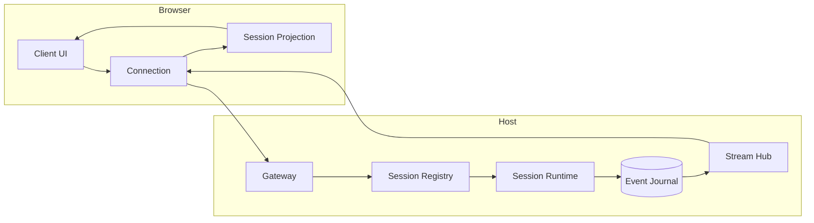

# 事件驱动的会话运行时

这个通用架构示例展示请求、持久化事件和客户端状态投影的职责。Host 初始收起，可通过加号查看内部模块；步骤切换保持当前展开状态。

::: diagram id="session-runtime"



```diagram-view
version: 1
details:
  "node:gateway": "#gateway"
  "node:registry": "#ownership"
  "node:runtime": "#ownership"
  "node:journal": "#journal"
  "node:stream": "#stream"
  "node:projection": "#projection"
links:
  "node:stream": "./recovery-sequence.md#cursor"
steps:
  - id: admission
    title: 接纳请求并路由会话
    focus: ["node:ui", "edge:submit", "node:connection", "edge:request", "node:gateway"]
    ref: "#gateway"
  - id: ownership
    title: 确认运行实例的归属
    focus: ["node:gateway", "edge:resolve", "node:registry", "edge:acquire", "node:runtime"]
    ref: "#ownership"
  - id: persistence
    title: 写入可恢复的事件
    focus: ["node:runtime", "edge:commit", "node:journal"]
    ref: "#journal"
  - id: distribution
    title: 分发事件并维护恢复位置
    focus: ["node:journal", "edge:publish", "node:stream", "edge:deliver", "node:connection"]
    ref: "#stream"
  - id: projection
    title: 重建客户端可见状态
    focus: ["node:connection", "edge:fold", "node:projection", "edge:update", "node:ui"]
    ref: "#projection"
```

:::

## 请求接纳与路由 {#gateway}

Gateway 处理身份、请求接纳和会话路由。运行实例的查找交给 Session Registry，连接断开与任务取消采用不同的状态语义。一次请求被接收，不代表其任务已经完成。

## 运行实例归属 {#ownership}

Session Registry 管理实例查找及生命周期归属，Session Runtime 处理具体任务。共享实例由拥有它的服务释放；一个客户端连接关闭时，先结束该连接的订阅，是否停止会话由会话自身的生命周期决定。

## 持久化事件 {#journal}

Event Journal 提供可排序的事件记录。任务输出、客户端投影和恢复逻辑围绕同一记录解释状态；失败响应应明确记录是否已经提交，避免调用方将未知结果当作可以安全重试。

## 事件分发与恢复 {#stream}

Stream Hub 管理事件订阅及连接恢复。历史回放与实时事件需要一个明确的交接窗口，连接恢复使用持久化游标确认位置。重复交付可以由接收端识别，恢复窗口中的遗漏则需要在订阅与回放协调处解决，具体时序见[连接恢复](recovery-sequence.md#cursor)。

## 客户端状态投影 {#projection}

Session Projection 按事件重建客户端可见状态，UI 从投影读取。客户端处理成功后推进已应用位置；重连时继续从该位置恢复。网络连接状态与会话任务状态分别展示，避免把传输中断解释成任务失败。
