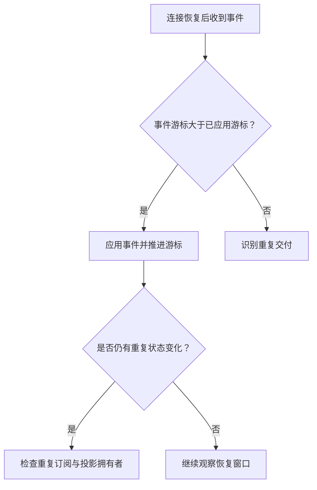

# 重连后重复应用事件

本文使用构造的症状说明问题分析文档如何组织。没有实际业务日志或源码审计结论；后续用于真实排查时，用证据替换示例输入。

## 示例输入

客户端已经应用游标 42 的事件，重连时服务端又交付了该事件。如果客户端再次执行状态累加，界面会展示重复结果。这里需要分别核实服务端回放范围、客户端的已应用位置，以及同一订阅是否被重复建立。

## 排查路径

这张普通 Mermaid 图没有声明侧栏或步骤控制。需要强调的证据和判断直接放在正文中。

## 待核实的假设

- 服务端使用包含起点的回放范围，客户端却假定起点被排除。
- 客户端把收到事件当成完成应用，恢复时使用了错误的确认位置。
- 断线重连创建新订阅后，旧订阅的拥有者或监听仍然存在。

## 方案与验证

先用日志和代码确认哪条假设成立，再明确游标推进点、回放范围和订阅释放职责。验证应覆盖重连、重复交付、取消与页面离开，不能只查看正常连接时的界面结果。架构职责见[运行时总览](architecture.md)，交接设计见[恢复时序](recovery-sequence.md#handoff)。
