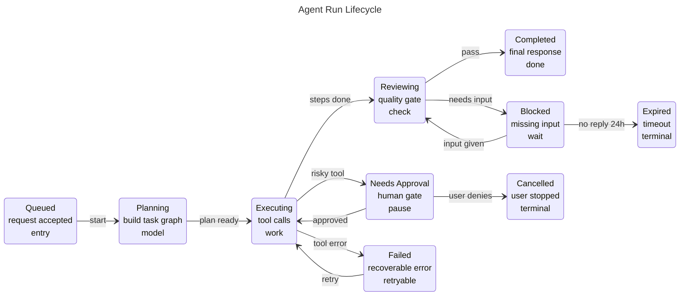

# Agent 运行状态与恢复

五阶段主线从 Queued 到 Completed。Needs Approval 和 Blocked 是等待状态，Failed 有重试回路；Cancelled 与 Expired 是终止出口。

::: diagram id="agent-lifecycle"



```diagram-view
version: 1
overview: "#overview"
details: {}
```

:::

## 阅读重点 {#overview}

五阶段主线从 Queued 到 Completed。Needs Approval 和 Blocked 是等待状态，Failed 有重试回路；Cancelled 与 Expired 是终止出口。

审批等待之后可 approved 返回 Executing，也可 user denies 进入 Cancelled。

Failed → Executing 与 Blocked → Reviewing 是不同恢复回路；原例的 no reply 24h 才让 Blocked 进入 Expired。

## 来源

- [agent-run.lifecycle.json](https://github.com/tt-a1i/archify/blob/7e45f36c66de1254d5ad6ba1d878f6499ea269fd/archify/examples/agent-run.lifecycle.json)，固定提交 `7e45f36c66de`。
