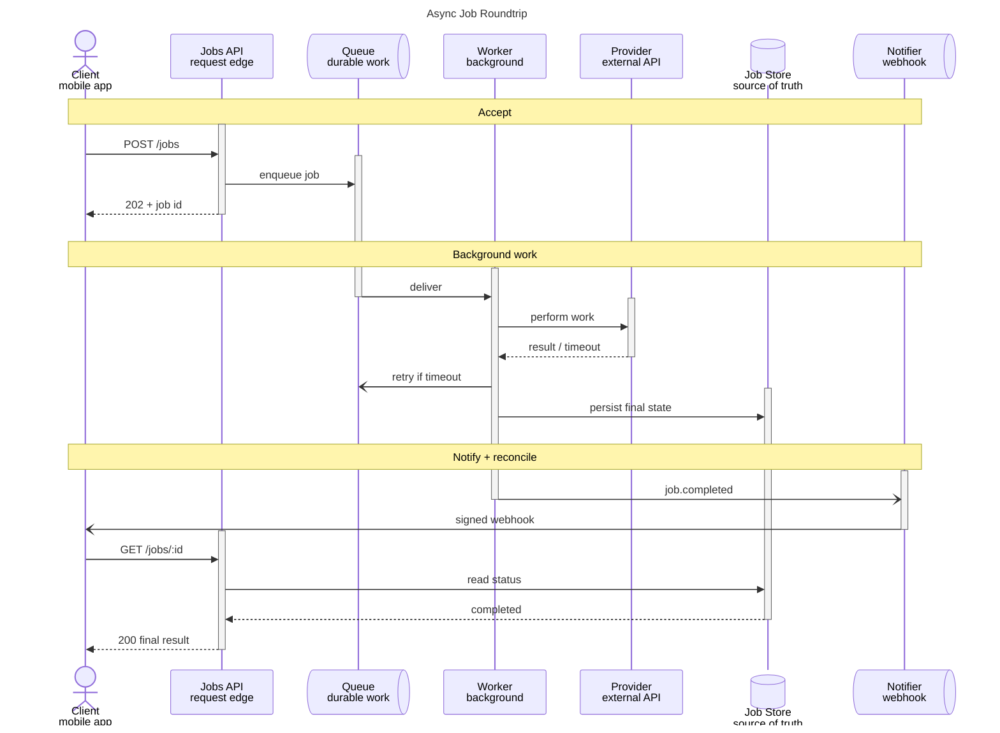

# 异步任务接纳、执行与结果对齐

Client 先取得 202 与 job id，再由 Queue、Worker 和 Provider 完成后台工作。超时可以重新入队；最终状态先持久化，再通知客户端。Webhook 与状态轮询收敛到同一个 Job Store。

::: diagram id="async-jobs"



```diagram-view
version: 1
overview: "#overview"
details:
  participant:n_client: "#participant-client"
  participant:n_api: "#participant-api"
  participant:n_queue: "#participant-queue"
  participant:n_worker: "#participant-worker"
  participant:n_provider: "#participant-provider"
  participant:n_store: "#participant-store"
  participant:n_notify: "#participant-notify"
  message:msg-1: "#participant-api"
  message:msg-2: "#participant-queue"
  message:msg-3: "#participant-client"
  message:msg-4: "#participant-worker"
  message:msg-5: "#participant-provider"
  message:msg-6: "#participant-worker"
  message:msg-7: "#participant-queue"
  message:msg-8: "#participant-store"
  message:msg-9: "#participant-notify"
  message:msg-10: "#participant-client"
  message:msg-11: "#participant-api"
  message:msg-12: "#participant-store"
  message:msg-13: "#participant-api"
  message:msg-14: "#participant-client"
```

:::

## 阅读重点 {#overview}

Client 先取得 202 与 job id，再由 Queue、Worker 和 Provider 完成后台工作。超时可以重新入队；最终状态先持久化，再通知客户端。Webhook 与状态轮询收敛到同一个 Job Store。

202 表示请求已被接纳，最终执行与外部供应方耗时属于后续后台过程。

原例把 result / timeout、retry if timeout、persist final state 与 signed webhook 分开，不能把通知当作状态事实本身。

## Client {#participant-client}

原例职责：mobile app。

客户端既接收签名 webhook，也可以用任务 ID 查询状态。

## Jobs API {#participant-api}

原例职责：request edge。

Jobs API 接纳请求并返回任务 ID；后续读取同一份任务状态。

## Queue {#participant-queue}

原例职责：durable work。

队列承担工作投递与超时后的重试交接。

## Worker {#participant-worker}

原例职责：background。

Worker 调用外部供应方，并先写入最终状态再发出完成通知。

## Provider {#participant-provider}

原例职责：external API。

外部供应方返回结果或超时，恢复策略由 Worker 的后续关系表达。

## Job Store {#participant-store}

原例职责：source of truth。

Job Store 是最终状态的事实来源，两条观察路径都以它为准。

## Notifier {#participant-notify}

原例职责：webhook。

Notifier 发送 job.completed 对应的签名 webhook。

## 来源

- [async-job-roundtrip.sequence.json](https://github.com/tt-a1i/archify/blob/7e45f36c66de1254d5ad6ba1d878f6499ea269fd/archify/examples/async-job-roundtrip.sequence.json)，固定提交 `7e45f36c66de`。
