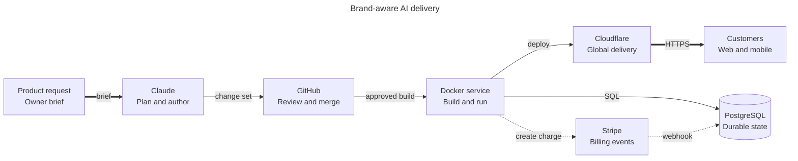

# AI 交付链与运行依赖

从产品需求开始，经 Claude 编写、GitHub 审查、Docker 构建运行，再通过 Cloudflare 交付给 Customers。PostgreSQL 和 Stripe 位于运行依赖及计费事件旁路。

::: diagram id="brand-delivery"



```diagram-view
version: 1
overview: "#overview"
details:
  node:n_request: "#role-external"
  node:n_claude: "#role-frontend"
  node:n_github: "#role-messagebus"
  node:n_container: "#role-backend"
  node:n_edge: "#role-cloud"
  node:n_customer: "#role-external"
  node:n_database: "#role-database"
  node:n_billing: "#role-external"
  edge:rel_brief_to_claude: "#role-frontend"
  edge:rel_claude_to_github: "#role-messagebus"
  edge:rel_github_to_container: "#role-backend"
  edge:rel_container_to_edge: "#role-cloud"
  edge:rel_edge_to_customer: "#role-external"
  edge:rel_container_to_database: "#role-database"
  edge:rel_container_to_billing: "#role-external"
  edge:rel_billing_to_database: "#role-database"
```

:::

## 阅读重点 {#overview}

从产品需求开始，经 Claude 编写、GitHub 审查、Docker 构建运行，再通过 Cloudflare 交付给 Customers。PostgreSQL 和 Stripe 位于运行依赖及计费事件旁路。

区分交付链条上的 change set、approved build、deploy，与运行时的 SQL、create charge、webhook。

产品名称保留英文，职责由颜色、节点副标题与实际连线共同说明。

## 外部角色 {#role-external}

区分系统使用者、外部供应方和运维参与者。沿着进入和离开系统的箭头，核对交接对象与返回方向。

## 交互入口 {#role-frontend}

入口接纳请求或采集事件，再把工作交给后续服务。入口职责与真正执行、保存状态的组件分别展示。

## 队列与异步 {#role-messagebus}

队列和事件关系将接纳、执行与通知分开。沿生产、投递、消费与返回路线，识别异步交接及其状态记录。

## 服务与执行 {#role-backend}

这一类组件承担业务执行。结合输入、输出与相邻服务，阅读执行责任以及跨组件交接。

## 基础设施 {#role-cloud}

基础设施说明流量入口、托管运行环境与部署范围。区域和网络分组表达归属，组件之间的箭头表达具体关系。

## 状态与存储 {#role-database}

缓存、主存储、归档与恢复副本各自承担不同状态责任。沿读写和复制关系判断数据归属，避免将它们视作可互换的存储。

## 来源

- [brand-aware-delivery.architecture.json](https://github.com/tt-a1i/archify/blob/7e45f36c66de1254d5ad6ba1d878f6499ea269fd/archify/examples/brand-aware-delivery.architecture.json)，固定提交 `7e45f36c66de`。
