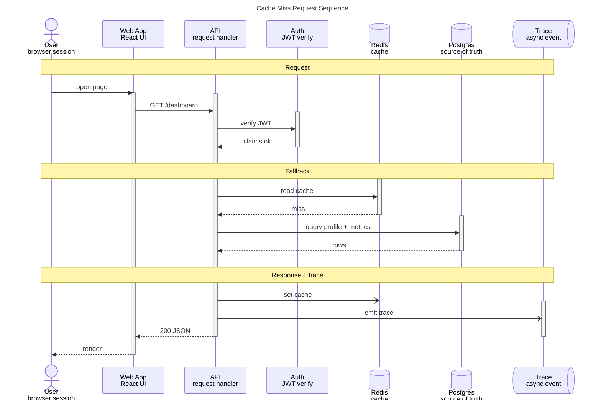

# 缓存未命中时序

保留原例七个参与者及十二条消息。对象颜色与生命线对应，数据库和队列使用 Mermaid 原生形状；调用、返回和异步通知保留各自的箭头形式。

::: diagram id="cache-miss"



```diagram-view
version: 1
details:
  message:verify: "#policy"
  message:miss: "#fallback"
  message:trace: "#response"
  participant:n_auth: "#policy"
  message:open: "#request"
  message:request: "#request"
  message:claims: "#request"
  message:cache-read: "#request"
  message:query: "#request"
  message:rows: "#request"
  message:cache-write: "#request"
  message:response: "#request"
  message:render: "#request"
  participant:n_user: "#request"
  participant:n_web: "#request"
  participant:n_api: "#request"
  participant:n_redis: "#fallback"
  participant:n_db: "#fallback"
  participant:n_trace: "#response"
steps:
  - id: request
    title: 页面请求与服务端处理区间
    focus:
      - message:open
      - message:request
    ref: "#request"
  - id: policy
    title: 查询数据之前验证身份
    focus:
      - message:verify
      - message:claims
      - participant:n_auth
    ref: "#policy"
  - id: miss
    title: 缓存未命中后访问主数据库
    focus:
      - message:cache-read
      - message:miss
      - message:query
      - message:rows
    ref: "#fallback"
  - id: response
    title: 写缓存、发送 Trace，再返回页面
    focus:
      - message:cache-write
      - message:trace
      - message:response
      - message:render
    ref: "#response"
```

:::

## 主请求与处理区间 {#request}

User 打开页面后，Web App 向 API 发起 GET /dashboard。激活条标识参与者正在处理这次交互的区间；生命线标识对象，不代表线程，也不说明独占资源。三个背景阶段分别表示请求、缓存回退、响应与追踪。定制版的消息颜色跟随发送方；丰富版区分普通、强调、安全、返回及异步消息，具体看图例。

## 认证检查 {#policy}

API 先调用 Auth 验证 JWT，取得 Claims OK 后继续读取数据。认证参与者使用独立的安全色；实线调用与虚线回复同时保留，不能仅凭颜色推断成功或失败。

## 缓存回退 {#fallback}

Redis 返回 Miss 后，API 才查询 Postgres 并取得 Rows。本例只描述缓存未命中路径，没有补充缓存命中分支。两个存储都使用数据库形状，但由名称、各自生命线及消息标签区分缓存与主数据。

## 辅助工作与响应 {#response}

原例将 Set cache 和 Emit trace 标为异步关系，这里以 Mermaid 的开放箭头表达。它们不要求接收方在图中返回确认；具体持久化保证和失败处理仍由实现决定。200 JSON 与 Render 是回复路径，不将它们与异步消息共用一种箭头。
