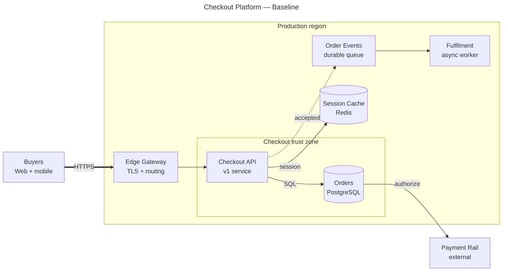
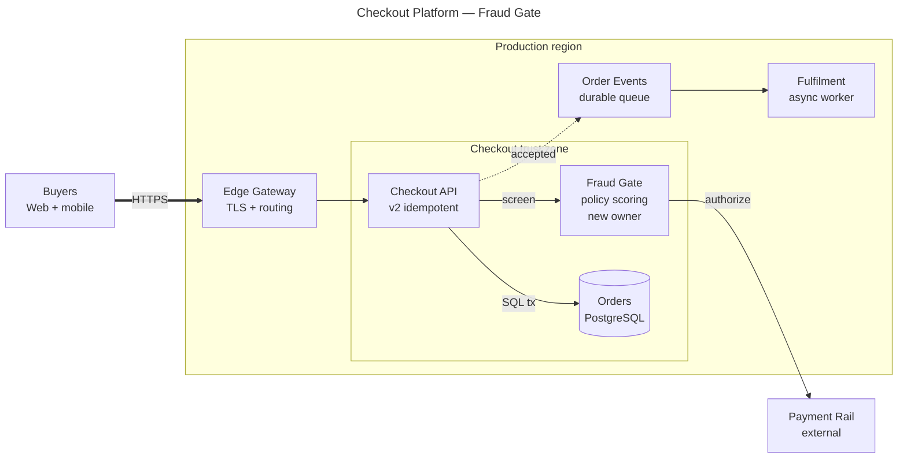

# Checkout 架构变更前后

对照相同的购物与履约范围：Baseline 包含 Session Cache；Fraud Gate 版本引入策略评分，并将 Checkout API 标注为 v2 idempotent。重点检查授权责任从哪里发出、信任范围如何变化。

## Baseline

::: diagram id="checkout-changes-before"



```diagram-view
version: 1
overview: "#before-overview"
details:
  group:boundary_1: "#before-role-security"
  group:boundary_0: "#before-role-cloud"
  node:n_buyers: "#before-role-external"
  node:n_edge: "#before-role-cloud"
  node:n_checkout: "#before-role-backend"
  node:n_cache: "#before-role-database"
  node:n_orders: "#before-role-database"
  node:n_queue: "#before-role-messagebus"
  node:n_worker: "#before-role-backend"
  node:n_payments: "#before-role-external"
  edge:rel_buyer_request: "#before-role-cloud"
  edge:rel_edge_checkout: "#before-role-backend"
  edge:rel_session_read: "#before-role-database"
  edge:rel_persist_order: "#before-role-database"
  edge:rel_publish_order: "#before-role-messagebus"
  edge:rel_consume_order: "#before-role-backend"
  edge:rel_authorize_payment: "#before-role-security"
```

:::

## Fraud Gate

::: diagram id="checkout-changes-after"



```diagram-view
version: 1
overview: "#after-overview"
details:
  group:boundary_1: "#after-role-security"
  group:boundary_0: "#after-role-cloud"
  node:n_buyers: "#after-role-external"
  node:n_edge: "#after-role-cloud"
  node:n_checkout: "#after-role-backend"
  node:n_fraud: "#after-role-security"
  node:n_orders: "#after-role-database"
  node:n_queue: "#after-role-messagebus"
  node:n_worker: "#after-role-backend"
  node:n_payments: "#after-role-external"
  edge:rel_buyer_request: "#after-role-cloud"
  edge:rel_edge_checkout: "#after-role-backend"
  edge:rel_fraud_check: "#after-role-security"
  edge:rel_persist_order: "#after-role-database"
  edge:rel_publish_order: "#after-role-messagebus"
  edge:rel_consume_order: "#after-role-backend"
  edge:rel_authorize_payment: "#after-role-security"
```

:::

## Baseline 阅读重点 {#before-overview}

对照相同的购物与履约范围：Baseline 包含 Session Cache；Fraud Gate 版本引入策略评分，并将 Checkout API 标注为 v2 idempotent。重点检查授权责任从哪里发出、信任范围如何变化。

原例两版均为 8 个组件、7 条关系。变化不能只靠节点数量判断。

Baseline 的 authorize 从 Orders 发往 Payment Rail；后一版改由 Fraud Gate 发出，同时保留订单持久化与异步履约。

## 外部角色 {#before-role-external}

区分系统使用者、外部供应方和运维参与者。沿着进入和离开系统的箭头，核对交接对象与返回方向。

## 基础设施 {#before-role-cloud}

基础设施说明流量入口、托管运行环境与部署范围。区域和网络分组表达归属，组件之间的箭头表达具体关系。

## 服务与执行 {#before-role-backend}

这一类组件承担业务执行。结合输入、输出与相邻服务，阅读执行责任以及跨组件交接。

## 状态与存储 {#before-role-database}

缓存、主存储、归档与恢复副本各自承担不同状态责任。沿读写和复制关系判断数据归属，避免将它们视作可互换的存储。

## 队列与异步 {#before-role-messagebus}

队列和事件关系将接纳、执行与通知分开。沿生产、投递、消费与返回路线，识别异步交接及其状态记录。

## 策略与信任 {#before-role-security}

安全相关的边和组件保留其检查条件及信任范围。拒绝、审批和加密传输分别按图中标签阅读，不能只凭颜色推断结果。

## Fraud Gate 阅读重点 {#after-overview}

对照相同的购物与履约范围：Baseline 包含 Session Cache；Fraud Gate 版本引入策略评分，并将 Checkout API 标注为 v2 idempotent。重点检查授权责任从哪里发出、信任范围如何变化。

原例两版均为 8 个组件、7 条关系。变化不能只靠节点数量判断。

Baseline 的 authorize 从 Orders 发往 Payment Rail；后一版改由 Fraud Gate 发出，同时保留订单持久化与异步履约。

## 外部角色 {#after-role-external}

区分系统使用者、外部供应方和运维参与者。沿着进入和离开系统的箭头，核对交接对象与返回方向。

## 基础设施 {#after-role-cloud}

基础设施说明流量入口、托管运行环境与部署范围。区域和网络分组表达归属，组件之间的箭头表达具体关系。

## 服务与执行 {#after-role-backend}

这一类组件承担业务执行。结合输入、输出与相邻服务，阅读执行责任以及跨组件交接。

## 策略与信任 {#after-role-security}

安全相关的边和组件保留其检查条件及信任范围。拒绝、审批和加密传输分别按图中标签阅读，不能只凭颜色推断结果。

## 状态与存储 {#after-role-database}

缓存、主存储、归档与恢复副本各自承担不同状态责任。沿读写和复制关系判断数据归属，避免将它们视作可互换的存储。

## 队列与异步 {#after-role-messagebus}

队列和事件关系将接纳、执行与通知分开。沿生产、投递、消费与返回路线，识别异步交接及其状态记录。

## 来源

- [checkout-platform.base.architecture.json](https://github.com/tt-a1i/archify/blob/7e45f36c66de1254d5ad6ba1d878f6499ea269fd/archify/examples/checkout-platform.base.architecture.json)，固定提交 `7e45f36c66de`。
- [checkout-platform.head.architecture.json](https://github.com/tt-a1i/archify/blob/7e45f36c66de1254d5ad6ba1d878f6499ea269fd/archify/examples/checkout-platform.head.architecture.json)，固定提交 `7e45f36c66de`。
