# 结账请求的并行执行瀑布

总请求耗时 1200ms。认证之后，库存查询与折扣计算从 100ms 同时开始；支付在 400ms 开始，最后写入订单。父 span 表达包络，不与子 span 耗时相加。

::: diagram id="checkout-waterfall"

```mermaid
---
title: "Checkout request execution"
---
  %% ccv:diagram {"kind":"waterfall","unit":"ms","evidence":"illustrative"}
gantt
  dateFormat x
  axisFormat %M:%S.%L
  todayMarker off
  section checkout-api
  %% ccv:node n_request {"detail":"Parent of every step below; its duration is not added to theirs."}
  POST /checkout :n_request, 0, 1200ms
  %% ccv:node n_discount {"parent":"n_request"}
  Calculate discount :n_discount, 100, 200ms
  %% ccv:node n_save {"parent":"n_request"}
  Write order :n_save, 1050, 150ms
  section identity
  %% ccv:node n_auth {"parent":"n_request"}
  Authenticate caller :n_auth, 0, 100ms
  section inventory
  %% ccv:node n_inventory {"parent":"n_request"}
  Look up inventory :n_inventory, 100, 300ms
  section payments
  %% ccv:node n_payment {"parent":"n_request"}
  Charge payment :n_payment, 400, 650ms
```



```diagram-view
version: 1
overview: "#overview"
details: {}
```

:::

## 阅读重点 {#overview}

总请求耗时 1200ms。认证之后，库存查询与折扣计算从 100ms 同时开始；支付在 400ms 开始，最后写入订单。父 span 表达包络，不与子 span 耗时相加。

库存查询 300ms 与折扣计算 200ms 是重叠区间，不是顺序相加的两步。

横轴以 MM:SS.mmm 显示从零开始的相对时间；表格保留原始毫秒数据。
### 原始 Span 数据

| Span ID | 名称 | 父 Span ID | 服务 | 开始 ms | 结束 ms | 耗时 ms |
| --- | --- | --- | --- | ---: | ---: | ---: |
| request | POST /checkout | — | checkout-api | 0 | 1200 | 1200 |
| auth | Authenticate caller | request | identity | 0 | 100 | 100 |
| inventory | Look up inventory | request | inventory | 100 | 400 | 300 |
| discount | Calculate discount | request | checkout-api | 100 | 300 | 200 |
| payment | Charge payment | request | payments | 400 | 1050 | 650 |
| save | Write order | request | checkout-api | 1050 | 1200 | 150 |

## 来源

- [checkout-request.waterfall.json](https://github.com/tt-a1i/archify/blob/7e45f36c66de1254d5ad6ba1d878f6499ea269fd/archify/examples/checkout-request.waterfall.json)，固定提交 `7e45f36c66de`。
