# 部署生命周期、健康暂停与回滚

从构建不可变镜像、测试和策略验证进入 Ready，再晋级为 Live。审批拒绝、构建撤回、健康暂停以及回滚成功或失败具有不同出口。

::: diagram id="deployment-lifecycle"

```mermaid
---
title: "Deployment Release Lifecycle"
---
  %% ccv:diagram {"kind":"lifecycle"}
stateDiagram-v2
  direction LR
  %% ccv:node n_queued {"step":"01","kind":"start","main":true}
  state "Queued<br/>change accepted<br/>pending" as n_queued
  %% ccv:node n_building {"step":"02","kind":"active","main":true}
  state "Building<br/>immutable image<br/>running" as n_building
  %% ccv:node n_verifying {"step":"03","kind":"decision","main":true}
  state "Verifying<br/>tests + policy<br/>gate" as n_verifying
  %% ccv:node n_ready {"step":"04","kind":"waiting","main":true}
  state "Ready<br/>promotion pending<br/>approved" as n_ready
  %% ccv:node n_live {"step":"05","kind":"success","main":true}
  state "Live<br/>production healthy<br/>success" as n_live
  %% ccv:node n_approval {"kind":"waiting"}
  state "Needs Approval<br/>release owner<br/>pause" as n_approval
  %% ccv:node n_cancelled {"kind":"failure"}
  state "Cancelled<br/>approval denied<br/>terminal" as n_cancelled
  %% ccv:node n_paused {"kind":"waiting"}
  state "Health Paused<br/>SLO regression<br/>observe" as n_paused
  %% ccv:node n_rollback {"kind":"active"}
  state "Rolling Back<br/>last good image<br/>automatic" as n_rollback
  %% ccv:node n_rolled_back {"kind":"success"}
  state "Rolled Back<br/>service restored<br/>terminal" as n_rolled_back
  %% ccv:node n_failed {"kind":"failure"}
  state "Failed<br/>rollback failed<br/>terminal" as n_failed
  %% ccv:node n_aborted {"kind":"neutral"}
  state "Aborted<br/>change withdrawn<br/>terminal" as n_aborted
  n_queued --> n_building: pick up
  n_building --> n_verifying: image built
  n_verifying --> n_ready: checks pass
  n_ready --> n_live: promote
  n_verifying --> n_building: tests fail
  %% ccv:edge transition-5 {"variant":"security"}
  n_verifying --> n_approval: needs sign-off
  n_approval --> n_ready: approved
  %% ccv:edge transition-7 {"variant":"security"}
  n_approval --> n_cancelled: denied
  %% ccv:edge transition-8 {"variant":"dashed"}
  n_live --> n_paused: SLO alert
  n_paused --> n_live: recovered
  %% ccv:edge transition-10 {"variant":"security"}
  n_paused --> n_rollback: breach persists
  %% ccv:edge transition-11 {"variant":"emphasis"}
  n_rollback --> n_rolled_back: restored
  %% ccv:edge transition-12 {"variant":"security"}
  n_rollback --> n_failed: rollback error
  n_building --> n_aborted: abort
  n_verifying --> n_aborted: abort
```



```diagram-view
version: 1
overview: "#overview"
details: {}
```

:::

## 阅读重点 {#overview}

从构建不可变镜像、测试和策略验证进入 Ready，再晋级为 Live。审批拒绝、构建撤回、健康暂停以及回滚成功或失败具有不同出口。

Verifying 的 tests fail 返回 Building；人工批准的暂停不等于已经取消发布。

Live 的 SLO alert 进入 Health Paused，可 recovered 返回 Live，也可 breach persists 进入 Rolling Back；回滚成功和失败分别落入不同终态。

## 来源

- [deployment-release.lifecycle.json](https://github.com/tt-a1i/archify/blob/7e45f36c66de1254d5ad6ba1d878f6499ea269fd/archify/examples/deployment-release.lifecycle.json)，固定提交 `7e45f36c66de`。
