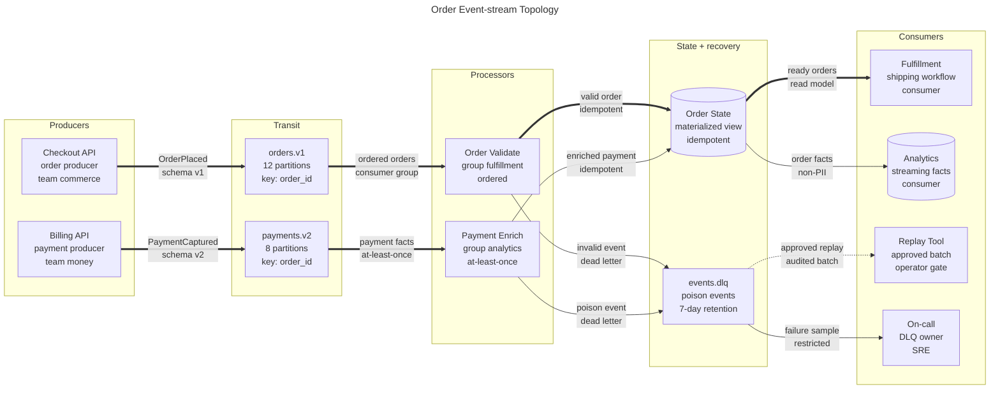

# 订单事件拓扑、死信与受控重放

订单与支付生产者写入不同版本和分区数的 Topic，处理器汇入幂等物化视图；Fulfillment 与 Analytics 消费不同结果，毒性事件进入 DLQ，由 On-call 检查并经受控批次重放。

::: diagram id="event-stream"



```diagram-view
version: 1
overview: "#overview"
details:
  node:n_checkout: "#stage-0"
  node:n_billing: "#stage-0"
  group:stage_0: "#stage-0"
  node:n_orders: "#stage-1"
  node:n_payments: "#stage-1"
  group:stage_1: "#stage-1"
  node:n_validate: "#stage-2"
  node:n_enrich: "#stage-2"
  group:stage_2: "#stage-2"
  node:n_state: "#stage-3"
  node:n_dlq: "#stage-3"
  group:stage_3: "#stage-3"
  node:n_fulfillment: "#stage-4"
  node:n_analytics: "#stage-4"
  node:n_replay: "#stage-4"
  node:n_ops: "#stage-4"
  group:stage_4: "#stage-4"
  edge:rel_0: "#stage-1"
  edge:rel_1: "#stage-1"
  edge:rel_2: "#stage-2"
  edge:rel_3: "#stage-2"
  edge:rel_4: "#stage-3"
  edge:rel_5: "#stage-3"
  edge:rel_6: "#stage-4"
  edge:rel_7: "#stage-4"
  edge:rel_8: "#stage-3"
  edge:rel_9: "#stage-3"
  edge:rel_10: "#stage-4"
  edge:rel_11: "#stage-4"
```

:::

## 阅读重点 {#overview}

订单与支付生产者写入不同版本和分区数的 Topic，处理器汇入幂等物化视图；Fulfillment 与 Analytics 消费不同结果，毒性事件进入 DLQ，由 On-call 检查并经受控批次重放。

At-least-once 投递不能直接推出业务效果只发生一次，原例用幂等物化视图区分这两件事。

失败样本和重放各有一条出口，不能把 DLQ 视作无主的终点。

## Producers {#stage-0}

Checkout API 与 Billing API 分别生产订单和支付事件，团队归属独立。

## Transit {#stage-1}

orders.v1 与 payments.v2 保留版本、分区数和 order_id 分区键。

## Processors {#stage-2}

Order Validate 与 Payment Enrich 属于不同消费组；有序和 at-least-once 标记分别保留。

## State + recovery {#stage-3}

Order State 是幂等物化视图，events.dlq 保存毒性事件并有 7-day retention。

## Consumers {#stage-4}

Fulfillment 与 Analytics 消费不同资产；On-call 检查失败样本，Replay Tool 执行获批、可审计的批量重放。

## 来源

- [event-stream.dataflow.json](https://github.com/tt-a1i/archify/blob/7e45f36c66de1254d5ad6ba1d878f6499ea269fd/archify/examples/event-stream.dataflow.json)，固定提交 `7e45f36c66de`。
