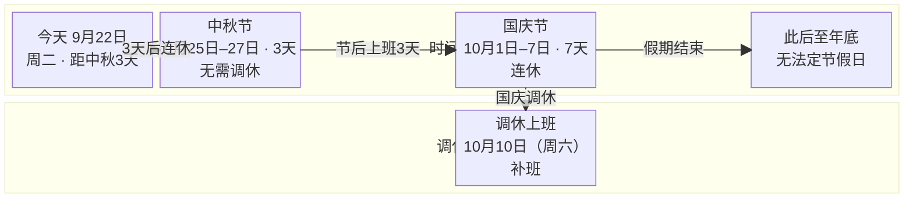

# 假期与补班排期示例

这是上游以 2026-09-22 为起点的固定排期示例：主线连接中秋、国庆与年末，国庆另有补班分支。用于比较日期标签、主线和分支的表达。

::: diagram id="holiday-planning"



```diagram-view
version: 1
overview: "#overview"
details:
  group:lane_0: "#lane-calendar"
  node:n_today: "#lane-calendar"
  node:n_mid_autumn: "#lane-calendar"
  node:n_national_day: "#lane-calendar"
  node:n_year_end: "#lane-calendar"
  group:lane_1: "#lane-makeup"
  node:n_makeup_work: "#lane-makeup"
  edge:1-n_today-n_mid_autumn: "#overview"
  edge:1-n_mid_autumn-n_national_day: "#overview"
  edge:1-n_national_day-n_year_end: "#overview"
  edge:1-n_national_day-n_makeup_work: "#overview"
```

:::

## 阅读重点 {#overview}

这是上游以 2026-09-22 为起点的固定排期示例：主线连接中秋、国庆与年末，国庆另有补班分支。用于比较日期标签、主线和分支的表达。

图中“今天”是源示例固定的 9 月 22 日，不会随阅读日期变化。

比较的是排期关系的图文表达，日期与文字沿用这一版本的示例内容。

## 时间线 {#lane-calendar}

时间主线按原例给定的日期推进，标签同时说明假期长度和间隔。

## 调休 {#lane-makeup}

调休泳道单独承载补班安排，避免与假期主线混为同一类节点。

## 来源

- [holiday-planning.workflow.json](https://github.com/tt-a1i/archify/blob/7e45f36c66de1254d5ad6ba1d878f6499ea269fd/archify/examples/holiday-planning.workflow.json)，固定提交 `7e45f36c66de`。
