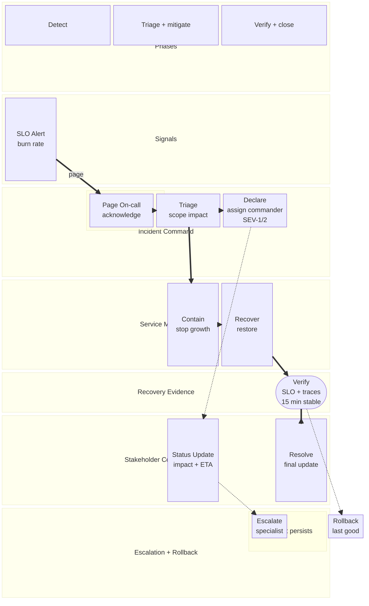

# 故障响应与恢复证据

SLO Alert 唤起 On-call，经过 Triage、Contain 和 Recover 后，用稳定窗口与观测数据验证恢复，再结束对外沟通。Declare、Status Update、Escalate 与 Rollback 保留为独立责任。

::: diagram id="incident-response"



```diagram-view
version: 1
overview: "#overview"
details:
  group:lane_0: "#lane-signals"
  node:n_alert: "#lane-signals"
  group:lane_1: "#lane-responders"
  node:n_page: "#lane-responders"
  node:n_triage: "#lane-responders"
  node:n_declare: "#lane-responders"
  group:lane_2: "#lane-mitigation"
  node:n_contain: "#lane-mitigation"
  node:n_recover: "#lane-mitigation"
  group:lane_3: "#lane-recovery"
  node:n_verify: "#lane-recovery"
  group:lane_4: "#lane-communication"
  node:n_close: "#lane-communication"
  node:n_update: "#lane-communication"
  group:workgroup_5_0: "#lane-exceptions"
  group:lane_5: "#lane-exceptions"
  node:n_escalate: "#lane-exceptions"
  node:n_rollback: "#lane-exceptions"
  group:phases: "#overview"
  node:phase_detect: "#overview"
  node:phase_respond: "#overview"
  node:phase_recover: "#overview"
  edge:1-n_alert-n_page: "#overview"
  edge:1-n_page-n_triage: "#overview"
  edge:1-n_triage-n_contain: "#overview"
  edge:1-n_contain-n_recover: "#overview"
  edge:1-n_recover-n_verify: "#overview"
  edge:1-n_verify-n_close: "#overview"
  edge:1-n_triage-n_declare: "#overview"
  edge:1-n_declare-n_update: "#overview"
  edge:1-n_update-n_escalate: "#overview"
  edge:1-n_verify-n_rollback: "#overview"
  group:workgroup_command: "#lane-responders"
```

:::

## 阅读重点 {#overview}

SLO Alert 唤起 On-call，经过 Triage、Contain 和 Recover 后，用稳定窗口与观测数据验证恢复，再结束对外沟通。Declare、Status Update、Escalate 与 Rollback 保留为独立责任。

沿主路径检查“收到告警—有人负责—影响被缓解—证据恢复—沟通关闭”五件不同的事。

Status Update → Escalate 及 Verify → Rollback 是原例的实际关系，不根据想象补全流程。

## Signals {#lane-signals}

SLO 告警提供触发信号，后续必须由具体响应者接纳。

## Incident Command {#lane-responders}

On-call 接受告警并划定影响，Declare 指定指挥角色；原例将声明与主缓解路线分开。

## Service Mitigation {#lane-mitigation}

Contain 限制影响扩散，Recover 恢复服务，两者都不能单独证明已完成恢复。

## Recovery Evidence {#lane-recovery}

Verify 使用 SLO 与 traces，并保留 15 min stable 的稳定窗口。

## Stakeholder Communication {#lane-communication}

Status Update 说明影响与 ETA，Resolve 在恢复证据之后给出最终状态。

## Escalation + Rollback {#lane-exceptions}

Escalate 指向所需专家，Rollback 是验证失败后的独立处理出口；不补充原例没有声明的回边。

## 来源

- [incident-response.workflow.json](https://github.com/tt-a1i/archify/blob/7e45f36c66de1254d5ad6ba1d878f6499ea269fd/archify/examples/incident-response.workflow.json)，固定提交 `7e45f36c66de`。
