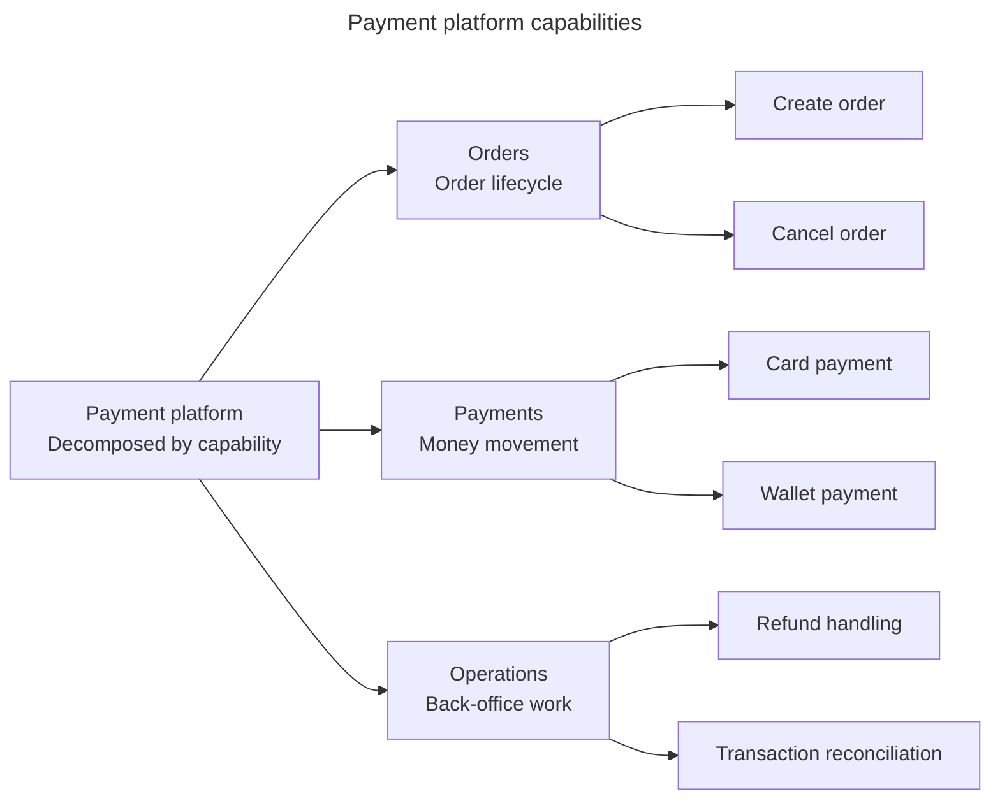

# 支付平台能力分解树

Payment platform 逐层分解为 Orders、Payments 和 Operations，再细分为创建 / 取消订单、卡 / 钱包支付、退款与对账。每个子能力只有一个父节点。

::: diagram id="payment-capabilities"



```diagram-view
version: 1
overview: "#overview"
details:
  node:n_platform: "#overview"
  node:n_orders: "#branch-orders"
  node:n_payments: "#branch-payments"
  node:n_operations: "#branch-operations"
  node:n_create_order: "#branch-orders"
  node:n_cancel_order: "#branch-orders"
  node:n_card_payment: "#branch-payments"
  node:n_wallet_payment: "#branch-payments"
  node:n_refunds: "#branch-operations"
  node:n_reconciliation: "#branch-operations"
  edge:contains_n_orders: "#branch-orders"
  edge:contains_n_payments: "#branch-payments"
  edge:contains_n_operations: "#branch-operations"
  edge:contains_n_create_order: "#branch-orders"
  edge:contains_n_cancel_order: "#branch-orders"
  edge:contains_n_card_payment: "#branch-payments"
  edge:contains_n_wallet_payment: "#branch-payments"
  edge:contains_n_refunds: "#branch-operations"
  edge:contains_n_reconciliation: "#branch-operations"
```

:::

## 阅读重点 {#overview}

Payment platform 逐层分解为 Orders、Payments 和 Operations，再细分为创建 / 取消订单、卡 / 钱包支付、退款与对账。每个子能力只有一个父节点。

树上的边表达包含，不表达 API 调用、消息顺序或继承。

先比较父子归属是否清楚，再比较分支间距与长标签的可读性。

## Orders {#branch-orders}

订单能力下分创建与取消，表达能力归属，而不是二者的执行先后。

## Payments {#branch-payments}

支付能力下分卡支付与钱包支付，渠道是同一父能力下的两个分支。

## Operations {#branch-operations}

退款和交易对账归属于后台运营能力。

## 来源

- [payment-platform.tree.json](https://github.com/tt-a1i/archify/blob/7e45f36c66de1254d5ad6ba1d878f6499ea269fd/archify/examples/payment-platform.tree.json)，固定提交 `7e45f36c66de`。
