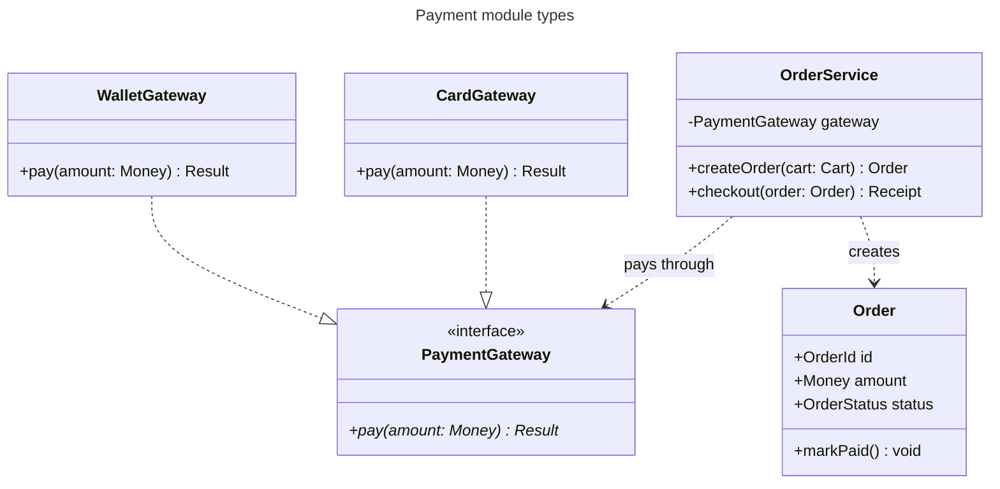

# 支付模块接口与渠道实现

OrderService 依赖 PaymentGateway 接口创建订单并启动支付；CardGateway 与 WalletGateway 分别实现渠道能力。五个类型保留属性、方法、可见性和四条关系。

::: diagram id="payment-classes"



```diagram-view
version: 1
overview: "#overview"
details: {}
```

:::

## 阅读重点 {#overview}

OrderService 依赖 PaymentGateway 接口创建订单并启动支付；CardGateway 与 WalletGateway 分别实现渠道能力。五个类型保留属性、方法、可见性和四条关系。

OrderService → PaymentGateway 是使用依赖；CardGateway / WalletGateway → PaymentGateway 是接口实现，箭头线型和端点不同。

Order 表达订单身份、金额和状态，不把实体与渠道服务合并为同一个类型。

## 来源

- [payments.class.json](https://github.com/tt-a1i/archify/blob/7e45f36c66de1254d5ad6ba1d878f6499ea269fd/archify/examples/payments.class.json)，固定提交 `7e45f36c66de`。
