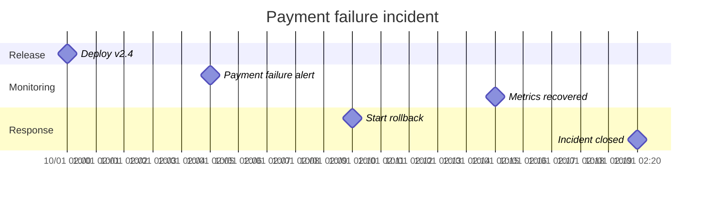

# 支付故障事件时间线

将发布、监控和响应三条来源放在同一时钟：10:00 部署、10:05 告警、10:10 回滚、10:15 恢复、10:20 关闭。时间间隔继续按真实时间比例表达。

::: diagram id="payment-incident"



```diagram-view
version: 1
overview: "#overview"
details: {}
```

:::

## 阅读重点 {#overview}

将发布、监控和响应三条来源放在同一时钟：10:00 部署、10:05 告警、10:10 回滚、10:15 恢复、10:20 关闭。时间间隔继续按真实时间比例表达。

这里使用 Mermaid Gantt 的里程碑表达原例时间点，统一显示 Asia/Shanghai 时区。

顺序与时间间隔来自源示例；相邻里程碑本身不额外声明因果或调用关系。
### 原始事件与时间戳

| 事件 | 原始时间戳 | 来源 | 说明 |
| --- | --- | --- | --- |
| Deploy v2.4 | 2026-10-01T10:00:00+08:00 | Release | New version starts serving payment requests. |
| Payment failure alert | 2026-10-01T10:05:00+08:00 | Monitoring | Error rate on /pay rises above the paging threshold. |
| Start rollback | 2026-10-01T10:10:00+08:00 | Response | On-call decides to return to v2.3. |
| Metrics recovered | 2026-10-01T10:15:00+08:00 | Monitoring | Payment success rate back to baseline. |
| Incident closed | 2026-10-01T10:20:00+08:00 | Response | Stability confirmed; response ends. |

## 来源

- [payment-incident.timeline.json](https://github.com/tt-a1i/archify/blob/7e45f36c66de1254d5ad6ba1d878f6499ea269fd/archify/examples/payment-incident.timeline.json)，固定提交 `7e45f36c66de`。
