# 支付处理器、共享恢复与继承层次

十一种类型包括结账编排器、注册表、处理器接口、重试基类、供应方实现、订单、明细与状态枚举。保留十条关系及全部成员。

::: diagram id="processor-hierarchy"

```mermaid
---
title: "Payment processor hierarchy"
---
  %% ccv:diagram {"kind":"class"}
classDiagram
  direction TB
  %% ccv:node checkout_orchestrator {"sublabel":"Runs one checkout from order to receipt","kind":"class"}
  class checkout_orchestrator["CheckoutOrchestrator"] {
    -ProcessorRegistry registry
    -Clock clock
    +checkout(order: Order, key: IdempotencyKey) CheckoutResult
    +cancelPendingAuthorization(orderId: OrderId) void
  }
  %% ccv:node processor_registry {"sublabel":"Selects a processor for a payment method","kind":"class"}
  class processor_registry["ProcessorRegistry"] {
    -Map~MethodType, PaymentProcessor~ processors
    +processorFor(method: PaymentMethod) PaymentProcessor
  }
  %% ccv:node payment_processor {"sublabel":"Authorize, capture, and refund contract","kind":"interface"}
  class payment_processor["PaymentProcessor"] {
    <<interface>>
    +authorize(request: AuthorizationRequest)* AuthorizationResult
    +capture(authorization: AuthorizationId, amount: Money)* CaptureResult
    +refund(capture: CaptureId, amount: Money)* RefundResult
  }
  %% ccv:node order {"sublabel":"Aggregate root for one purchase","kind":"class"}
  class order["Order"] {
    +OrderId id
    +Money total
    +PaymentStatus status
    +addLine(sku: Sku, quantity: int) LineItem
    +markAuthorized(authorization: AuthorizationId) void
  }
  %% ccv:node payment_status {"sublabel":"Lifecycle of the order's payment","kind":"enum"}
  class payment_status["PaymentStatus"] {
    <<enum>>
    PENDING
    AUTHORIZED
    CAPTURED
    REFUNDED
    FAILED
  }
  %% ccv:node retrying_processor {"sublabel":"Shared retry, timeout, and idempotency handling","kind":"abstract"}
  class retrying_processor["RetryingProcessorBase"] {
    <<abstract>>
    +Duration DEFAULT_TIMEOUT$
    #RetryPolicy retryPolicy
    +authorize(request: AuthorizationRequest) AuthorizationResult
    #sendToProvider(request: ProviderRequest)* ProviderResponse
  }
  %% ccv:node bank_transfer {"sublabel":"Asynchronous transfer without provider retries","kind":"class"}
  class bank_transfer["BankTransferProcessor"] {
    +authorize(request: AuthorizationRequest) AuthorizationResult
    -awaitSettlement(transfer: TransferId) SettlementResult
  }
  %% ccv:node line_item {"sublabel":"Immutable priced order line","kind":"record"}
  class line_item["LineItem"] {
    <<record>>
    +Sku sku
    +int quantity
    +Money unitPrice
  }
  %% ccv:node stripe_card {"sublabel":"Card payments through Stripe","kind":"class"}
  class stripe_card["StripeCardProcessor"] {
    #sendToProvider(request: ProviderRequest) ProviderResponse
  }
  %% ccv:node adyen_card {"sublabel":"Card payments through Adyen","kind":"class"}
  class adyen_card["AdyenCardProcessor"] {
    #sendToProvider(request: ProviderRequest) ProviderResponse
  }
  %% ccv:node paypal_wallet {"sublabel":"Wallet payments through PayPal","kind":"class"}
  class paypal_wallet["PayPalWalletProcessor"] {
    #sendToProvider(request: ProviderRequest) ProviderResponse
    -exchangeBillingAgreementToken(token: String) AgreementId
  }
  checkout_orchestrator --> processor_registry : selects via
  processor_registry o-- payment_processor : holds
  checkout_orchestrator ..> order : updates
  order *-- line_item : owns lines
  order --> payment_status
  retrying_processor ..|> payment_processor
  bank_transfer ..|> payment_processor
  stripe_card --|> retrying_processor
  adyen_card --|> retrying_processor
  paypal_wallet --|> retrying_processor
```



```diagram-view
version: 1
overview: "#overview"
details: {}
```

:::

## 阅读重点 {#overview}

十一种类型包括结账编排器、注册表、处理器接口、重试基类、供应方实现、订单、明细与状态枚举。保留十条关系及全部成员。

ProcessorRegistry 聚合 PaymentProcessor；Order 组合 LineItem；依赖、聚合与组合不画成同一种箭头。

RetryingProcessorBase 实现统一接口并被三个供应方继承；BankTransferProcessor 直接实现接口，以保留异步转账的差异。

枚举、record、protected 成员、静态超时和抽象方法均在类型框中表达。

## 来源

- [payment-processors.class.json](https://github.com/tt-a1i/archify/blob/7e45f36c66de1254d5ad6ba1d878f6499ea269fd/archify/examples/payment-processors.class.json)，固定提交 `7e45f36c66de`。
