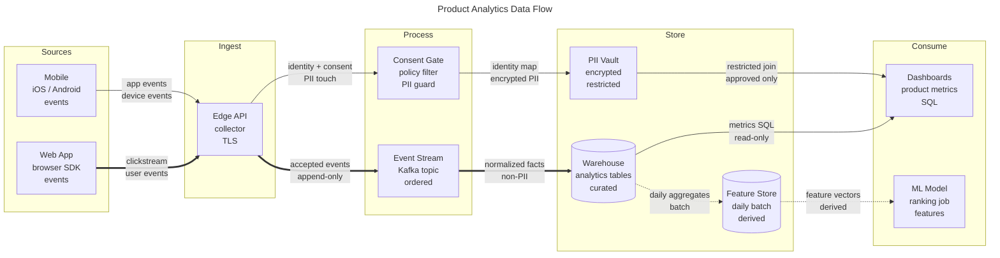

# 产品分析数据流与 PII 分离

Web 与 Mobile 事件进入 Edge API，经 Consent Gate 与 Event Stream 处理后流向 PII Vault、Warehouse 和 Feature Store，最终供 Dashboards 与 ML Model 消费。

::: diagram id="product-analytics"



```diagram-view
version: 1
overview: "#overview"
details:
  node:n_web: "#stage-0"
  node:n_mobile: "#stage-0"
  group:stage_0: "#stage-0"
  node:n_edge: "#stage-1"
  group:stage_1: "#stage-1"
  node:n_consent: "#stage-2"
  node:n_stream: "#stage-2"
  group:stage_2: "#stage-2"
  node:n_pii: "#stage-3"
  node:n_warehouse: "#stage-3"
  node:n_features: "#stage-3"
  group:stage_3: "#stage-3"
  node:n_dashboard: "#stage-4"
  node:n_model: "#stage-4"
  group:stage_4: "#stage-4"
  edge:rel_web_clickstream: "#stage-1"
  edge:rel_mobile_events: "#stage-1"
  edge:rel_consent_enrichment: "#stage-2"
  edge:rel_accepted_events: "#stage-2"
  edge:rel_identity_map: "#stage-3"
  edge:rel_normalized_facts: "#stage-3"
  edge:rel_daily_aggregates: "#stage-3"
  edge:rel_metrics_query: "#stage-4"
  edge:rel_feature_vectors: "#stage-4"
  edge:rel_restricted_join: "#stage-4"
```

:::

## 阅读重点 {#overview}

Web 与 Mobile 事件进入 Edge API，经 Consent Gate 与 Event Stream 处理后流向 PII Vault、Warehouse 和 Feature Store，最终供 Dashboards 与 ML Model 消费。

敏感身份映射与非 PII 分析事实分开保存；受限关联标注 approved only。

日聚合和特征向量使用派生关系，和采集热路径保留区别。

## Sources {#stage-0}

Web 和 Mobile 是两个独立事件来源，分别保留 clickstream 与 app events。

## Ingest {#stage-1}

Edge API 承担采集入口；identity + consent 与 accepted events 分往不同处理路径。

## Process {#stage-2}

Consent Gate 承担策略过滤，Event Stream 承担有序追加事件，两者职责不同。

## Store {#stage-3}

PII Vault 保存受限身份映射，Warehouse 保存分析事实，Feature Store 是每日派生结果。

## Consume {#stage-4}

Dashboards 的 metrics SQL、restricted join 与 ML Model 的 feature vectors 各有独立数据来源。

## 来源

- [product-analytics.dataflow.json](https://github.com/tt-a1i/archify/blob/7e45f36c66de1254d5ad6ba1d878f6499ea269fd/archify/examples/product-analytics.dataflow.json)，固定提交 `7e45f36c66de`。
