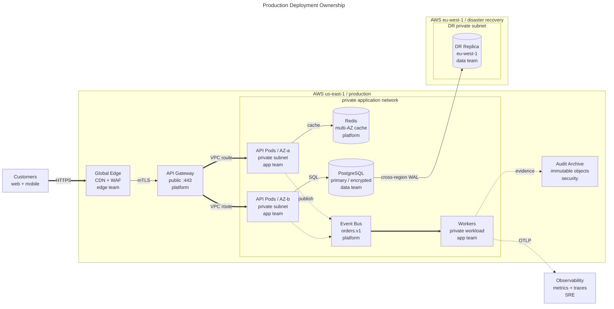

# 生产部署与跨区域灾备

从 Customers → Global Edge → API Gateway 进入生产区域，两个可用区分别承载 API Pods。主路径之外还保留缓存、事件消费、跨区域 WAL、不可变审计归档及可观测性输出。

::: diagram id="production-deployment"



```diagram-view
version: 1
overview: "#overview"
details:
  group:boundary_1: "#role-security"
  group:boundary_0: "#role-cloud"
  group:boundary_3: "#role-security"
  group:boundary_2: "#role-cloud"
  node:n_clients: "#role-external"
  node:n_edge: "#role-cloud"
  node:n_gateway: "#role-security"
  node:n_api_a: "#role-backend"
  node:n_api_b: "#role-backend"
  node:n_redis: "#role-database"
  node:n_postgres: "#role-database"
  node:n_events: "#role-messagebus"
  node:n_worker: "#role-backend"
  node:n_replica: "#role-database"
  node:n_audit: "#role-cloud"
  node:n_observability: "#role-external"
  edge:rel_0: "#role-cloud"
  edge:rel_1: "#role-security"
  edge:rel_2: "#role-backend"
  edge:rel_3: "#role-backend"
  edge:rel_4: "#role-database"
  edge:rel_5: "#role-database"
  edge:rel_6: "#role-messagebus"
  edge:rel_7: "#role-messagebus"
  edge:rel_8: "#role-backend"
  edge:rel_9: "#role-security"
  edge:rel_10: "#role-cloud"
  edge:rel_11: "#role-external"
```

:::

## 阅读重点 {#overview}

从 Customers → Global Edge → API Gateway 进入生产区域，两个可用区分别承载 API Pods。主路径之外还保留缓存、事件消费、跨区域 WAL、不可变审计归档及可观测性输出。

生产区域与应用私有网络是不同的包含层级，DR 区域与其私有子网也分别保留。

跨区域 WAL 指向灾备副本；Workers 的审计和 OTLP 输出属于执行旁路。原例的 owner 标签继续留在组件中。

## 外部角色 {#role-external}

区分系统使用者、外部供应方和运维参与者。沿着进入和离开系统的箭头，核对交接对象与返回方向。

## 基础设施 {#role-cloud}

基础设施说明流量入口、托管运行环境与部署范围。区域和网络分组表达归属，组件之间的箭头表达具体关系。

## 策略与信任 {#role-security}

安全相关的边和组件保留其检查条件及信任范围。拒绝、审批和加密传输分别按图中标签阅读，不能只凭颜色推断结果。

## 服务与执行 {#role-backend}

这一类组件承担业务执行。结合输入、输出与相邻服务，阅读执行责任以及跨组件交接。

## 状态与存储 {#role-database}

缓存、主存储、归档与恢复副本各自承担不同状态责任。沿读写和复制关系判断数据归属，避免将它们视作可互换的存储。

## 队列与异步 {#role-messagebus}

队列和事件关系将接纳、执行与通知分开。沿生产、投递、消费与返回路线，识别异步交接及其状态记录。

## 来源

- [production-deployment.architecture.json](https://github.com/tt-a1i/archify/blob/7e45f36c66de1254d5ad6ba1d878f6499ea269fd/archify/examples/production-deployment.architecture.json)，固定提交 `7e45f36c66de`。
