# 三 Worker 示例重建瀑布

保留上游一次本地测量中的 25 个 span：三台逻辑 Worker 并发重建八个示例，每个示例又包含 render 和 artifact check。整个批次包络为 1286.2ms。

::: diagram id="rebuild-waterfall"

```mermaid
---
title: "Rebuilding the bundled examples"
---
  %% ccv:diagram {"kind":"waterfall","unit":"ms","evidence":"measured"}
gantt
  dateFormat x
  axisFormat %M:%S.%L
  todayMarker off
  section undefined
  Rebuild bundled examples (3 workers) :n_batch, 0, 1286.2ms
  section worker 1
  %% ccv:node n_ex0 {"parent":"n_batch"}
  web-app.architecture :n_ex0, 0.2, 429.5ms
  %% ccv:node n_ex0_render {"parent":"n_ex0"}
  render-architecture.mjs :n_ex0_render, 0.2, 263.1ms
  %% ccv:node n_ex0_check {"parent":"n_ex0"}
  check-render-output.mjs :n_ex0_check, 263.3, 166.39999999999998ms
  %% ccv:node n_ex4 {"parent":"n_batch"}
  agent-run.lifecycle :n_ex4, 429.8, 432.99999999999994ms
  %% ccv:node n_ex4_render {"parent":"n_ex4"}
  render-lifecycle.mjs :n_ex4_render, 429.8, 213.90000000000003ms
  %% ccv:node n_ex4_check {"parent":"n_ex4"}
  check-render-output.mjs :n_ex4_check, 643.7, 219.0999999999999ms
  %% ccv:node n_ex7 {"parent":"n_batch"}
  checkout-request.waterfall :n_ex7, 862.8, 423.4000000000001ms
  %% ccv:node n_ex7_render {"parent":"n_ex7"}
  render-waterfall.mjs :n_ex7_render, 862.8, 219.70000000000005ms
  %% ccv:node n_ex7_check {"parent":"n_ex7"}
  check-render-output.mjs :n_ex7_check, 1082.5, 203.70000000000005ms
  section worker 2
  %% ccv:node n_ex1 {"parent":"n_batch"}
  agent-tool-call.workflow :n_ex1, 1.6, 443.59999999999997ms
  %% ccv:node n_ex1_render {"parent":"n_ex1"}
  render-workflow.mjs :n_ex1_render, 1.6, 296.9ms
  %% ccv:node n_ex1_check {"parent":"n_ex1"}
  check-render-output.mjs :n_ex1_check, 298.5, 146.7ms
  %% ccv:node n_ex5 {"parent":"n_batch"}
  orders.erd :n_ex5, 445.2, 423.09999999999997ms
  %% ccv:node n_ex5_render {"parent":"n_ex5"}
  render-erd.mjs :n_ex5_render, 445.2, 200.7ms
  %% ccv:node n_ex5_check {"parent":"n_ex5"}
  check-render-output.mjs :n_ex5_check, 645.9, 222.39999999999998ms
  section worker 3
  %% ccv:node n_ex2 {"parent":"n_batch"}
  cache-miss-request.sequence :n_ex2, 2.2, 396.2ms
  %% ccv:node n_ex2_render {"parent":"n_ex2"}
  render-sequence.mjs :n_ex2_render, 2.2, 222.20000000000002ms
  %% ccv:node n_ex2_check {"parent":"n_ex2"}
  check-render-output.mjs :n_ex2_check, 224.4, 173.99999999999997ms
  %% ccv:node n_ex3 {"parent":"n_batch"}
  product-analytics.dataflow :n_ex3, 398.4, 432.30000000000007ms
  %% ccv:node n_ex3_render {"parent":"n_ex3"}
  render-dataflow.mjs :n_ex3_render, 398.4, 195ms
  %% ccv:node n_ex3_check {"parent":"n_ex3"}
  check-render-output.mjs :n_ex3_check, 593.4, 237.30000000000007ms
  %% ccv:node n_ex6 {"parent":"n_batch"}
  subscription-billing.erd :n_ex6, 830.7, 400.5999999999999ms
  %% ccv:node n_ex6_render {"parent":"n_ex6"}
  render-erd.mjs :n_ex6_render, 830.7, 191.5ms
  %% ccv:node n_ex6_check {"parent":"n_ex6"}
  check-render-output.mjs :n_ex6_check, 1022.2, 209.0999999999999ms
```



```diagram-view
version: 1
overview: "#overview"
details: {}
```

:::

## 阅读重点 {#overview}

保留上游一次本地测量中的 25 个 span：三台逻辑 Worker 并发重建八个示例，每个示例又包含 render 和 artifact check。整个批次包络为 1286.2ms。

这些数值来自上游示例的一次测量，不是本次生成对照页的性能结果。

Gantt 按毫秒刻度展示位置，表格继续保留原例的 0.1ms 数值；父子 span 与并发 Worker 的时间不能直接累加。
### 原始 Span 数据

| Span ID | 名称 | 父 Span ID | 服务 | 开始 ms | 结束 ms | 耗时 ms |
| --- | --- | --- | --- | ---: | ---: | ---: |
| batch | Rebuild bundled examples (3 workers) | — | Batch | 0 | 1286.2 | 1286.2 |
| ex0 | web-app.architecture | batch | worker 1 | 0.2 | 429.7 | 429.5 |
| ex0_render | render-architecture.mjs | ex0 | worker 1 | 0.2 | 263.3 | 263.1 |
| ex0_check | check-render-output.mjs | ex0 | worker 1 | 263.3 | 429.7 | 166.4 |
| ex1 | agent-tool-call.workflow | batch | worker 2 | 1.6 | 445.2 | 443.6 |
| ex1_render | render-workflow.mjs | ex1 | worker 2 | 1.6 | 298.5 | 296.9 |
| ex1_check | check-render-output.mjs | ex1 | worker 2 | 298.5 | 445.2 | 146.7 |
| ex2 | cache-miss-request.sequence | batch | worker 3 | 2.2 | 398.4 | 396.2 |
| ex2_render | render-sequence.mjs | ex2 | worker 3 | 2.2 | 224.4 | 222.2 |
| ex2_check | check-render-output.mjs | ex2 | worker 3 | 224.4 | 398.4 | 174 |
| ex3 | product-analytics.dataflow | batch | worker 3 | 398.4 | 830.7 | 432.3 |
| ex3_render | render-dataflow.mjs | ex3 | worker 3 | 398.4 | 593.4 | 195 |
| ex3_check | check-render-output.mjs | ex3 | worker 3 | 593.4 | 830.7 | 237.3 |
| ex4 | agent-run.lifecycle | batch | worker 1 | 429.8 | 862.8 | 433 |
| ex4_render | render-lifecycle.mjs | ex4 | worker 1 | 429.8 | 643.7 | 213.9 |
| ex4_check | check-render-output.mjs | ex4 | worker 1 | 643.7 | 862.8 | 219.1 |
| ex5 | orders.erd | batch | worker 2 | 445.2 | 868.3 | 423.1 |
| ex5_render | render-erd.mjs | ex5 | worker 2 | 445.2 | 645.9 | 200.7 |
| ex5_check | check-render-output.mjs | ex5 | worker 2 | 645.9 | 868.3 | 222.4 |
| ex6 | subscription-billing.erd | batch | worker 3 | 830.7 | 1231.3 | 400.6 |
| ex6_render | render-erd.mjs | ex6 | worker 3 | 830.7 | 1022.2 | 191.5 |
| ex6_check | check-render-output.mjs | ex6 | worker 3 | 1022.2 | 1231.3 | 209.1 |
| ex7 | checkout-request.waterfall | batch | worker 1 | 862.8 | 1286.2 | 423.4 |
| ex7_render | render-waterfall.mjs | ex7 | worker 1 | 862.8 | 1082.5 | 219.7 |
| ex7_check | check-render-output.mjs | ex7 | worker 1 | 1082.5 | 1286.2 | 203.7 |

## 来源

- [example-rebuild.waterfall.json](https://github.com/tt-a1i/archify/blob/7e45f36c66de1254d5ad6ba1d878f6499ea269fd/archify/examples/example-rebuild.waterfall.json)，固定提交 `7e45f36c66de`。
