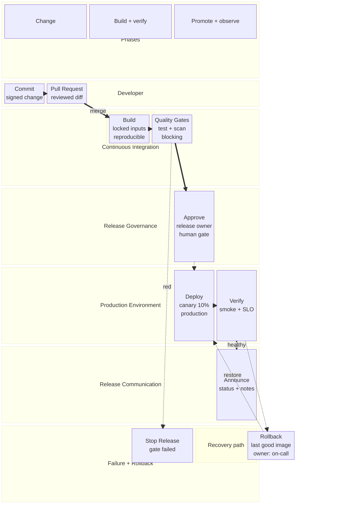

# 发布交付、质量门禁与回滚

提交与 Pull Request 经构建、质量门禁和人工审批后进入灰度发布；生产验证健康才通知发布完成。门禁失败停止晋级，生产验证失败则进入 Rollback，再恢复到 Deploy。

::: diagram id="release-delivery"



```diagram-view
version: 1
overview: "#overview"
details:
  group:phases: "#phases"
  node:phase_change: "#phases"
  node:phase_verify: "#phases"
  node:phase_promote: "#phases"
  group:lane_0: "#lane-dev"
  node:n_commit: "#lane-dev"
  node:n_pull_request: "#lane-dev"
  group:workgroup_1_0: "#lane-ci"
  group:lane_1: "#lane-ci"
  node:n_build: "#lane-ci"
  node:n_checks: "#lane-ci"
  group:lane_2: "#lane-approval"
  node:n_approval: "#lane-approval"
  group:lane_3: "#lane-environment"
  node:n_deploy: "#lane-environment"
  node:n_verify_prod: "#lane-environment"
  group:lane_4: "#lane-communication"
  node:n_announce: "#lane-communication"
  group:workgroup_5_0: "#lane-exceptions"
  group:lane_5: "#lane-exceptions"
  node:n_failed: "#lane-exceptions"
  node:n_rollback: "#lane-exceptions"
  edge:1-n_commit-n_pull_request: "#lane-dev"
  edge:1-n_pull_request-n_build: "#lane-ci"
  edge:1-n_build-n_checks: "#lane-ci"
  edge:1-n_checks-n_approval: "#lane-approval"
  edge:1-n_approval-n_deploy: "#lane-environment"
  edge:1-n_deploy-n_verify_prod: "#lane-environment"
  edge:1-n_verify_prod-n_announce: "#lane-communication"
  edge:1-n_checks-n_failed: "#lane-exceptions"
  edge:1-n_verify_prod-n_rollback: "#lane-exceptions"
  edge:1-n_rollback-n_deploy: "#lane-exceptions"
```

:::

## 阅读重点 {#overview}

提交与 Pull Request 经构建、质量门禁和人工审批后进入灰度发布；生产验证健康才通知发布完成。门禁失败停止晋级，生产验证失败则进入 Rollback，再恢复到 Deploy。

原例把审批、不可变镜像和检查结果作为发布证据。

通知不是生产成功的判定节点；健康验证和回滚责任都在图中显式保留。

## 三个发布阶段 {#phases}

Change 包含提交与评审；Build + verify 包含可复现构建和阻断检查；Promote + observe 包含人工审批、生产发布和健康观察。横向表示阶段推进，纵向表示责任交接；六条泳道保持独立，失败与恢复路径放在异常泳道。

## Developer {#lane-dev}

开发者负责签名提交和经过评审的差异；Merge 关系才把输入交给 CI。

## Continuous Integration {#lane-ci}

构建强调锁定输入，Quality Gates 同时覆盖测试和扫描。红色失败分支进入 Stop Release。

## Release Governance {#lane-approval}

Release Owner 承担明确的人工批准责任，和自动质量检查分开。

## Production Environment {#lane-environment}

Deploy 从 canary 10% 开始，Verify 用 smoke 与 SLO 检查生产健康；回滚可以重新进入 Deploy。

## Release Communication {#lane-communication}

Announce 位于健康验证之后，发布状态与说明以验证结果为依据。

## Failure + Rollback {#lane-exceptions}

Stop Release 处理门禁失败并停止晋级；生产 Verify 失败进入 Rollback，由 on-call 使用 last good image 执行恢复。restore 回边通过独立的返回通道重新进入 Deploy，与向下的发布主线区分。

## 来源

- [release-delivery.workflow.json](https://github.com/tt-a1i/archify/blob/7e45f36c66de1254d5ad6ba1d878f6499ea269fd/archify/examples/release-delivery.workflow.json)，固定提交 `7e45f36c66de`。
