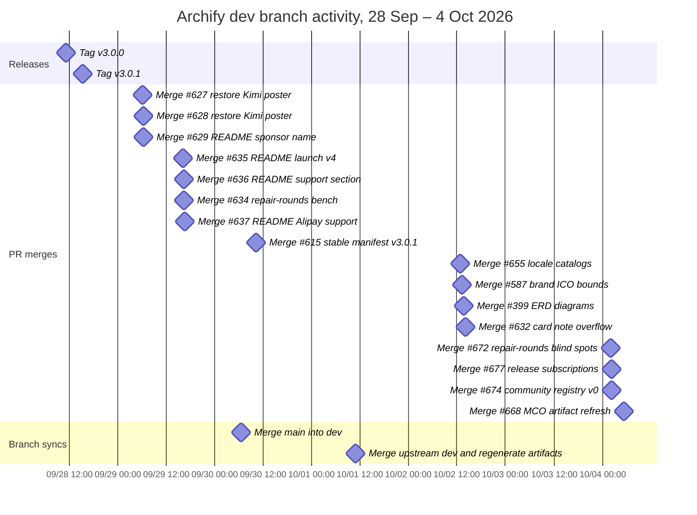

# Archify 发布与合并活动时间线

保留上游 2026-09-28 至 10-04 的二十个事件，分为 Releases、PR merges 和 Branch syncs。不同原始时区偏移统一到同一显示时区。

::: diagram id="repository-history"



```diagram-view
version: 1
overview: "#overview"
details: {}
```

:::

## 阅读重点 {#overview}

保留上游 2026-09-28 至 10-04 的二十个事件，分为 Releases、PR merges 和 Branch syncs。不同原始时区偏移统一到同一显示时区。

事件沿用此版本示例中的 tag 与 merge 记录，不把它们解释为当前分支状态。

原始时间戳保留在事件表中，图中统一按 Asia/Shanghai 对齐。时间接近不等于同一事件。
### 原始事件与时间戳

| 事件 | 原始时间戳 | 来源 | 说明 |
| --- | --- | --- | --- |
| Tag v3.0.0 | 2026-09-28T19:13:16+08:00 | Releases | git tag v3.0.0 |
| Tag v3.0.1 | 2026-09-28T23:16:27+08:00 | Releases | git tag v3.0.1 |
| Merge #627 restore Kimi poster | 2026-09-29T14:16:30+08:00 | PR merges | Merge commit on dev |
| Merge #628 restore Kimi poster | 2026-09-29T14:17:35+08:00 | PR merges | Merge commit on dev |
| Merge #629 README sponsor name | 2026-09-29T14:28:59+08:00 | PR merges | Merge commit on dev |
| Merge #635 README launch v4 | 2026-09-30T00:15:40+08:00 | PR merges | Merge commit on dev |
| Merge #636 README support section | 2026-09-30T00:23:38+08:00 | PR merges | Merge commit on dev |
| Merge #634 repair-rounds bench | 2026-09-30T00:23:57+08:00 | PR merges | Merge commit on dev |
| Merge #637 README Alipay support | 2026-09-30T00:42:24+08:00 | PR merges | Merge commit on dev |
| Merge main into dev | 2026-09-30T14:36:59+08:00 | Branch syncs | Merge commit on dev |
| Merge #615 stable manifest v3.0.1 | 2026-09-30T18:19:15+08:00 | PR merges | Merge commit on dev |
| Merge upstream dev and regenerate artifacts | 2026-10-01T16:28:51+05:30 | Branch syncs | Merge commit on dev |
| Merge #655 locale catalogs | 2026-10-02T20:49:57+08:00 | PR merges | Merge commit on dev |
| Merge #587 brand ICO bounds | 2026-10-02T21:13:51+08:00 | PR merges | Merge commit on dev |
| Merge #399 ERD diagrams | 2026-10-02T21:36:46+08:00 | PR merges | Merge commit on dev |
| Merge #632 card note overflow | 2026-10-02T22:08:03+08:00 | PR merges | Merge commit on dev |
| Merge #672 repair-rounds blind spots | 2026-10-04T09:57:08+08:00 | PR merges | Merge commit on dev |
| Merge #677 release subscriptions | 2026-10-04T10:14:55+08:00 | PR merges | Merge commit on dev |
| Merge #674 community registry v0 | 2026-10-04T10:17:01+08:00 | PR merges | Merge commit on dev |
| Merge #668 MCO artifact refresh | 2026-10-04T13:18:18+08:00 | PR merges | Merge commit on dev |

## 来源

- [archify-dev-activity.timeline.json](https://github.com/tt-a1i/archify/blob/7e45f36c66de1254d5ad6ba1d878f6499ea269fd/archify/examples/archify-dev-activity.timeline.json)，固定提交 `7e45f36c66de`。
