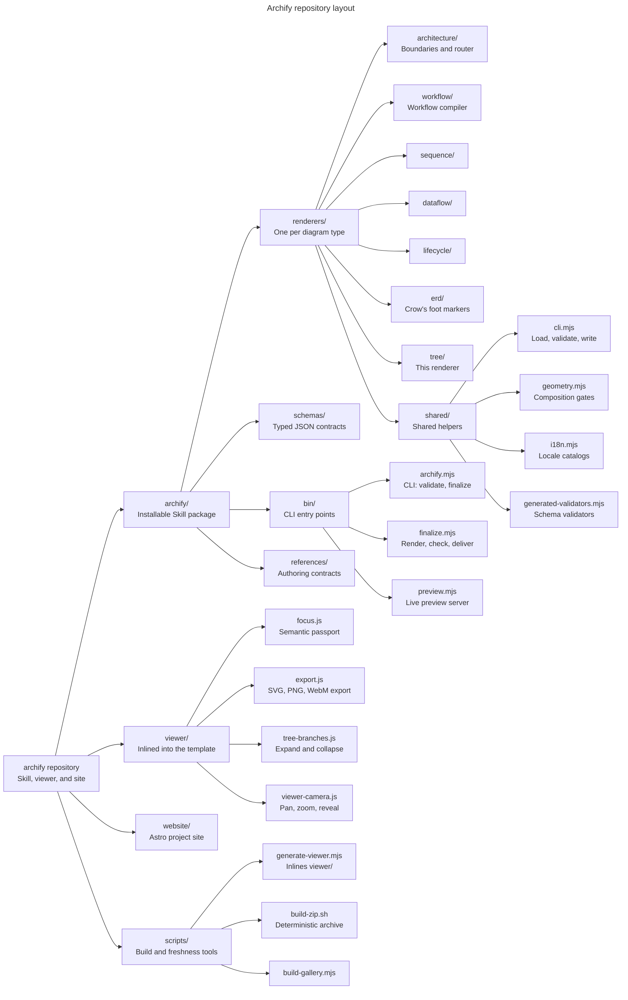

# Archify 仓库结构分解

使用上游示例中的 31 个目录与文件节点，区分可安装 Skill、Viewer、网站和构建脚本。继续展开 renderers、shared 和 CLI 子树，比较源码导航的组织方式。

::: diagram id="repository-tree"



```diagram-view
version: 1
overview: "#overview"
details:
  node:n_repo: "#overview"
  node:n_skill: "#branch-skill"
  node:n_viewer: "#branch-viewer"
  node:n_site: "#branch-site"
  node:n_scripts: "#branch-scripts"
  node:n_renderers: "#branch-skill"
  node:n_schemas: "#branch-skill"
  node:n_bin: "#branch-skill"
  node:n_references: "#branch-skill"
  node:n_r_arch: "#branch-skill"
  node:n_r_workflow: "#branch-skill"
  node:n_r_sequence: "#branch-skill"
  node:n_r_dataflow: "#branch-skill"
  node:n_r_lifecycle: "#branch-skill"
  node:n_r_erd: "#branch-skill"
  node:n_r_tree: "#branch-skill"
  node:n_r_shared: "#branch-skill"
  node:n_s_cli: "#branch-skill"
  node:n_s_geometry: "#branch-skill"
  node:n_s_i18n: "#branch-skill"
  node:n_s_validators: "#branch-skill"
  node:n_b_archify: "#branch-skill"
  node:n_b_finalize: "#branch-skill"
  node:n_b_preview: "#branch-skill"
  node:n_v_focus: "#branch-viewer"
  node:n_v_export: "#branch-viewer"
  node:n_v_tree: "#branch-viewer"
  node:n_v_camera: "#branch-viewer"
  node:n_sc_viewer: "#branch-scripts"
  node:n_sc_zip: "#branch-scripts"
  node:n_sc_gallery: "#branch-scripts"
  edge:contains_n_skill: "#branch-skill"
  edge:contains_n_viewer: "#branch-viewer"
  edge:contains_n_site: "#branch-site"
  edge:contains_n_scripts: "#branch-scripts"
  edge:contains_n_renderers: "#branch-skill"
  edge:contains_n_schemas: "#branch-skill"
  edge:contains_n_bin: "#branch-skill"
  edge:contains_n_references: "#branch-skill"
  edge:contains_n_r_arch: "#branch-skill"
  edge:contains_n_r_workflow: "#branch-skill"
  edge:contains_n_r_sequence: "#branch-skill"
  edge:contains_n_r_dataflow: "#branch-skill"
  edge:contains_n_r_lifecycle: "#branch-skill"
  edge:contains_n_r_erd: "#branch-skill"
  edge:contains_n_r_tree: "#branch-skill"
  edge:contains_n_r_shared: "#branch-skill"
  edge:contains_n_s_cli: "#branch-skill"
  edge:contains_n_s_geometry: "#branch-skill"
  edge:contains_n_s_i18n: "#branch-skill"
  edge:contains_n_s_validators: "#branch-skill"
  edge:contains_n_b_archify: "#branch-skill"
  edge:contains_n_b_finalize: "#branch-skill"
  edge:contains_n_b_preview: "#branch-skill"
  edge:contains_n_v_focus: "#branch-viewer"
  edge:contains_n_v_export: "#branch-viewer"
  edge:contains_n_v_tree: "#branch-viewer"
  edge:contains_n_v_camera: "#branch-viewer"
  edge:contains_n_sc_viewer: "#branch-scripts"
  edge:contains_n_sc_zip: "#branch-scripts"
  edge:contains_n_sc_gallery: "#branch-scripts"
```

:::

## 阅读重点 {#overview}

使用上游示例中的 31 个目录与文件节点，区分可安装 Skill、Viewer、网站和构建脚本。继续展开 renderers、shared 和 CLI 子树，比较源码导航的组织方式。

本页描述的是该提交附带的 Archify 源示例，不是 clearcode-view 自身的目录。

原版 viewer 分支初始收起；本版完整展示同一组节点，便于核对全部路径。

## archify/ {#branch-skill}

archify/ 是可安装的 Skill 包，容纳渲染器、Schema、CLI 和 authoring references。

## viewer/ {#branch-viewer}

viewer/ 管理语义聚焦、导出、树分支与镜头，最终内联到模板。

## website/ {#branch-site}

website/ 是 Astro 项目站点，和生成图形的运行时职责分开。

## scripts/ {#branch-scripts}

scripts/ 保存 Viewer 生成、归档和图库等构建与时效检查工具。

## 来源

- [archify-repository.tree.json](https://github.com/tt-a1i/archify/blob/7e45f36c66de1254d5ad6ba1d878f6499ea269fd/archify/examples/archify-repository.tree.json)，固定提交 `7e45f36c66de`。
