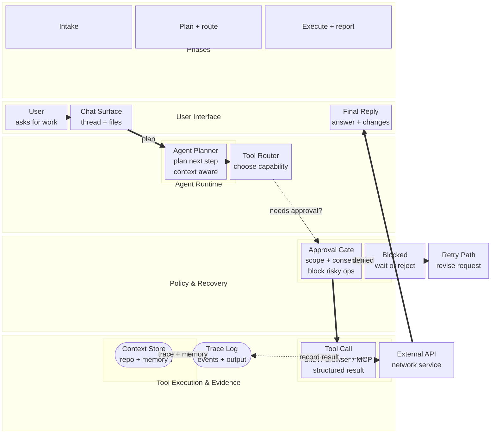

# Agent 分层架构与流转

四层表达职责，箭头表达层内调用和跨层交接。保留原例十二个组件与十一条关系，区分执行主线、审批拒绝、结果返回和证据记录；选择组件或连线可查看中文解读。

::: diagram id="agent-workflow"



```diagram-view
version: 1
overview: "#layers"
details:
  group:ui: "#interface"
  group:agent: "#runtime"
  group:policy: "#policy"
  node:user: "#interface"
  node:chat: "#interface"
  node:final: "#interface"
  node:planner: "#runtime"
  node:router: "#runtime"
  node:approval: "#policy"
  node:blocked: "#policy"
  node:retry: "#policy"
  node:tool: "#execution"
  node:external: "#execution"
  node:store: "#evidence"
  node:trace: "#evidence"
  edge:1-user-chat: "#interface"
  edge:1-chat-planner: "#runtime"
  edge:1-planner-router: "#runtime"
  edge:1-router-approval: "#policy"
  edge:1-approval-tool: "#policy"
  edge:1-approval-blocked: "#policy"
  edge:1-blocked-retry: "#policy"
  edge:1-tool-external: "#execution"
  edge:1-external-final: "#response"
  edge:1-external-trace: "#evidence"
  edge:1-store-trace: "#evidence"
  group:phases: "#layers"
  node:phase_intake: "#layers"
  node:phase_reasoning: "#layers"
  node:phase_execution: "#layers"
  group:workgroup_agent_loop: "#runtime"
  group:workgroup_exception_path: "#policy"
  group:lane_3: "#execution"
  group:workgroup_evidence_path: "#evidence"
  group:workgroup_tool_work: "#execution"
```

:::

## 四层职责与路线 {#layers}

从上到下是界面、规划、策略、执行与证据四层。User → Chat Surface 接纳任务；Agent Planner → Tool Router 规划并路由；Approval Gate 根据授权条件分到 Tool Call 或 Blocked → Retry Path；External API 的结果返回 Final Reply，另一路写入 Trace Log。

横向的三个阶段是请求与上下文、规划与路由、执行与报告；纵向四层区分责任，内部工作组突出规划循环、人工阻断、工具调用和证据。粗线突出规划、获准执行和结果返回，安全及异步关系各有线型与图例。定制版的箭头颜色对应接收组件，丰富版按关系类别配色。整张图同时展示这些关系，不需要按步骤播放。

## 界面层 · User Interface {#interface}

User 通过箭头将任务交给 Chat Surface，后者承载线程、文件与交互入口，并将任务交给规划层。Final Reply 接收执行结果并呈现答案与改动；它与输入入口属于同一层，但承担返回方向的职责。

## 规划层 · Agent Runtime {#runtime}

Chat Surface 经 Plan 路线进入 Agent Planner，规划器再调用 Tool Router 选择能力。层内的 Planner → Router 明确表达先确定工作内容、再选择执行能力；Router 通过 Needs approval? 路线把待检查的调用交给策略层。

## 策略层 · Policy & Recovery {#policy}

Approval Gate 检查操作范围和用户授权。获准的主路径进入执行层 Tool Call；denied 分支进入 Blocked，再交给 Retry Path 等待、拒绝或修订请求。这两个出口分别表达获准执行和被阻断后的处理。

原例在 Retry Path 结束拒绝分支，没有声明自动重新规划或重新授权的回边，因此图中不补充这类关系。

## 执行层 · Tool Execution {#execution}

Tool Call 接纳获准的调用，并通过层内实线访问 External API。它统一表示 shell、browser 或 MCP 能力；External API 表示外部网络服务。执行结果沿 Result 路线回到界面层，记录关系则通向 Trace Log。

## 结果返回 {#response}

External API → Final Reply 是原例的返回路线，从执行层回到界面层。右侧粗线将这条跨层返回与向下执行的路线区分，表示结果交付关系；具体运行时的封装和调度不由此公开示例定义。

## 证据记录 · Evidence {#evidence}

External API 通过 Record result 路线向 Trace Log 写入结果；Context Store 通过 Trace + memory 路线关联仓库、记忆与记录。这两条虚线分别保留执行结果与上下文证据的来源，不把它们合并为顺序执行步骤。
