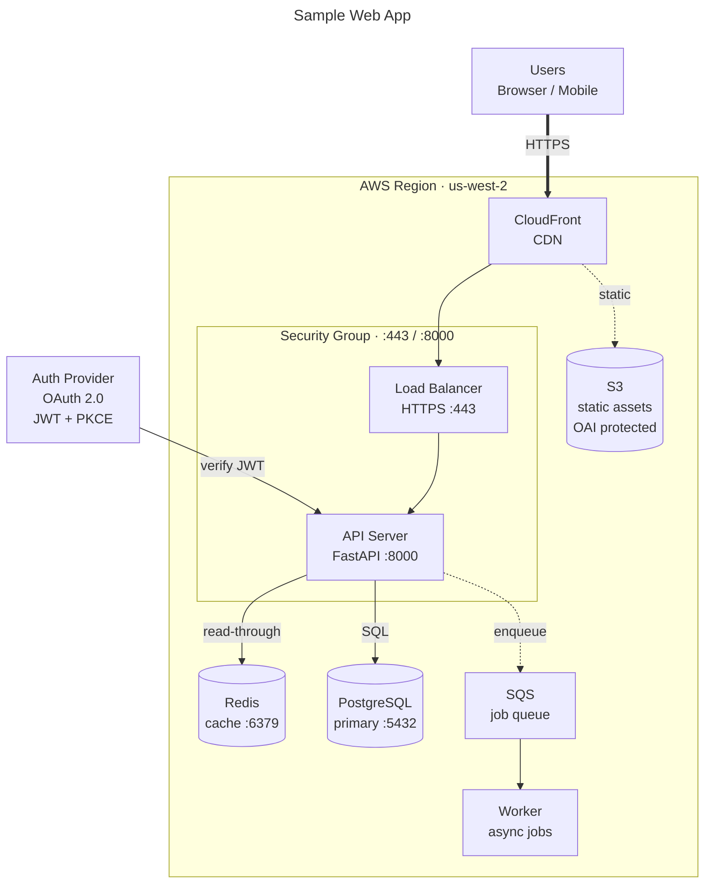

# Web 应用架构

改编自其 Sample Web App 示例：保留十个组件、九条关系、区域与安全组。配色表达职责，虚线与粗线保留作者的关系区分，具体含义见连线标签及解读。

::: diagram id="sample-web-app"



```diagram-view
version: 1
details:
  node:cdn: "#edge"
  node:s3: "#edge"
  node:api: "#application"
  node:cache: "#application"
  node:db: "#application"
  node:auth: "#security"
  group:apiGroup: "#security"
  node:queue: "#background"
  node:worker: "#background"
steps:
  - id: ingress
    title: 从边缘入口到应用服务
    focus:
      - node:users
      - edge:entry
      - node:cdn
      - edge:forward
      - node:lb
      - edge:dispatch
      - node:api
    ref: "#edge"
  - id: policy
    title: 将认证关系与部署隔离分开阅读
    focus:
      - node:auth
      - edge:policy
      - group:apiGroup
    ref: "#security"
  - id: persistence
    title: 缓存与主数据库承担不同职责
    focus:
      - node:api
      - edge:cached
      - node:cache
      - edge:query
      - node:db
    ref: "#application"
  - id: background
    title: 队列隔离后台工作
    focus:
      - edge:enqueue
      - node:queue
      - edge:execute
      - node:worker
    ref: "#background"
```

:::

## 边缘入口与静态资源 {#edge}

Users 通过 HTTPS 到达 CloudFront；应用请求经过 Load Balancer 交给 API Server。静态资源由 CloudFront 连接 S3，原例注明资源受 OAI 保护。这张图表达依赖及流量方向，不意味着一次请求同时访问所有组件。

## 认证与部署隔离 {#security}

Auth Provider 提供 OAuth 2.0，原例标记 JWT 与 PKCE。Verify JWT 关系以安全色区分；安全组框只包围 Load Balancer 与 API Server，区域框包围区域内八个组件。认证检查与部署隔离是两类约束，不能靠同一种虚线框混为一谈。

## 缓存与持久化 {#application}

API Server 使用 Redis read-through 缓存，并通过 SQL 访问 PostgreSQL。Redis 与主数据库同属存储类别，但名字、形状和关系标签分别说明缓存与主数据职责。缓存未命中时的先后顺序需要查看[时序图](cache-miss.md)，静态架构图不补造这些时序。

## 后台任务 {#background}

API Server 将工作提交到 SQS，Worker 消费队列中的任务。Enqueue 使用虚线；API、队列和 Worker 保持独立，方便讨论提交成功、消费执行和用户响应之间的关系。
