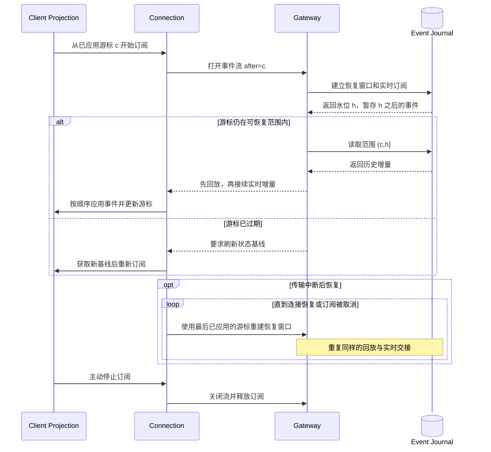

# 带游标的连接恢复

这个通用时序示例讲解历史回放、实时交接和取消。消息前的 ccv 注释提供稳定讲解标识，可以通过步骤控件选择对应消息，也可以直接点击参与者或消息查看说明。

::: diagram id="recovery"



```diagram-view
version: 1
details:
  "participant:C": "#cursor"
  "participant:T": "#cancel"
  "participant:G": "#handoff"
  "participant:J": "#handoff"
  "message:window": "#handoff"
  "message:expired": "#expired"
  "message:cancel": "#cancel"
steps:
  - id: restore-position
    title: 从客户端已应用位置恢复
    focus: ["message:subscribe", "message:open"]
    ref: "#cursor"
  - id: capture-window
    title: 建立回放与实时事件的交接窗口
    focus: ["message:window", "message:watermark"]
    ref: "#handoff"
  - id: replay
    title: 回放窗口内的历史增量
    focus: ["message:read", "message:replay", "message:handoff", "message:apply"]
    ref: "#handoff"
  - id: expired
    title: 无法继续回放时刷新基线
    focus: ["message:expired", "message:refresh"]
    ref: "#expired"
  - id: reconnect
    title: 使用已应用游标重连
    focus: ["message:reconnect", "participant:T", "participant:G"]
    ref: "#cursor"
  - id: cancel
    title: 显式取消并释放订阅
    focus: ["message:cancel", "message:close"]
    ref: "#cancel"
```

:::

::: diagram-details

## 已应用游标 {#cursor}

游标记录客户端成功应用的位置。传输接收、交付给 UI 和完成应用是不同阶段；恢复时选用哪一阶段的游标会决定重复或遗漏风险。示例选用已应用游标，允许接收端识别重复交付。

## 历史回放与实时交接 {#handoff}

先订阅并建立水位 h，再读取历史范围 (c,h]，可以为历史与实时事件定义连续的交接点。示例假定 Event Journal 能协调水位和暂存订阅；实际系统需要核实这一能力由哪个存储或分发服务提供。只先查询历史再开始订阅，会留下需要处理的交接窗口。

## 过期游标 {#expired}

历史已清理时，客户端需要刷新快照或其他状态基线，然后取得与基线一致的新游标。服务端明确返回无法回放的状态，客户端据此切换恢复路径。

## 取消与断线 {#cancel}

取消表示用户或拥有者结束订阅，应释放相关资源。断线表示传输不可用，可以在仍拥有订阅意图时重试。两者使用不同的控制状态，重试循环在取消后结束。

:::
